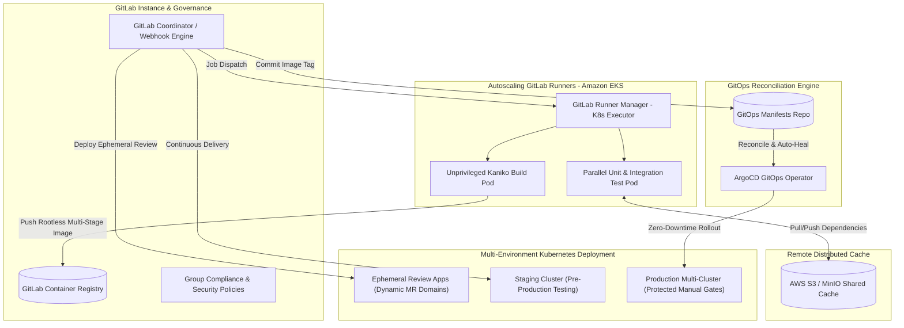

# GitLab CI/CD Masterclass for Enterprise DevOps & GitOps

> **Enterprise DevOps, Platform Engineering နှင့် GitOps တို့အတွက် GitLab CI/CD လက်တွေ့အသုံးချ သင်ခန်းစာများနှင့် Production Incident ဖြေရှင်းနည်းများ စုစည်းမှု။**  
> ရှင်းလင်းပြတ်သားသော မြန်မာဘာသာ ရှင်းလင်းချက်များ၊ Standard English နည်းပညာအသုံးအနှုန်းများ၊ Mermaid Architecture Diagrams များနှင့် Production-Grade `.gitlab-ci.yml` ကုဒ်များဖြင့် ပြည့်စုံစွာ ရေးသားထားပါသည်။

---

## 🏗️ High-Level Enterprise GitLab CI/CD Architecture

ခေတ်မီ Cloud-Native Enterprise Platform တစ်ခုတွင် GitLab CI/CD သည် Kubernetes Cluster များ၊ Security Compliance Framework များ နှင့် GitOps Controllers (ArgoCD) တို့နှင့် အောက်ပါအတိုင်း ချိတ်ဆက်လည်ပတ်ပါသည်:



---

## 📑 မာတိကာ (Table of Contents)

### 🚀 Quick Reference & Tools
- [**GitLab CI/CD Cheatsheet**](gitlab-ci-cheatsheet.md) - `.gitlab-ci.yml` Keywords, Predefined CI Variables, `rules` Syntax များနှင့် `glab` CLI အသုံးပြုနည်း လက်စွဲ။

---

### 📚 LESSON NOTES (အဆင့်ဆင့် လေ့လာရန် လက်တွေ့သင်ခန်းစာများ)

| အခန်း | သင်ခန်းစာခေါင်းစဉ် | အဓိက လေ့လာရမည့် အကြောင်းအရာများ | ဖိုင်လမ်းကြောင်း |
| :---: | :--- | :--- | :---: |
| **01** | **GitLab CI/CD Architecture & Core Fundamentals** | Coordinator vs Runners, Docker/K8s Executors, Stages, Jobs, Script Hooks, **Artifacts vs Cache နှိုင်းယှဉ်ချက်** | [View Lesson 1](notes/lesson-01-architecture-and-fundamentals.md) |
| **02** | **Modern Control Flow & Pipeline Optimization** | `rules:if/changes/exists`, **DAG `needs:` (Sequential Bottlenecks ဖယ်ရှားခြင်း)**, `workflow:rules` (Double Pipelines တားဆီးခြင်း) | [View Lesson 2](notes/lesson-02-control-flow-and-optimization.md) |
| **03** | **Secure Container Image Building with Kaniko** | DinD Security Risks, **Rootless Builds with Google Kaniko**, Multi-stage Dockerfiles, Remote Layer Caching | [View Lesson 3](notes/lesson-03-kaniko-container-builds.md) |
| **04** | **Reusable CI/CD Architecture & Corporate Governance** | Modularity (`include:project/local`), `.base_job` Inheritance (`extends:`), **CI/CD Components Catalog**, Group Compliance Pipelines | [View Lesson 4](notes/lesson-04-reusable-architecture-and-governance.md) |
| **05** | **Multi-Environment Deployments, GitOps & Security Gates** | **Dynamic Review Apps**, Protected Environments & Manual Gates, HashiCorp Vault OIDC JWT, **Built-in DevSecOps Scanners (SAST, Secrets, CVEs)** | [View Lesson 5](notes/lesson-05-deployments-gitops-and-security.md) |

---

### 🚨 REAL-WORLD SCENARIOS (Production Incident Resolutions)

| Incident | ပြဿနာနှင့် ဖြေရှင်းချက် (Real-World Case Studies) | အဓိက အသုံးပြုထားသော နည်းပညာများ | ဖိုင်လမ်းကြောင်း |
| :---: | :--- | :--- | :---: |
| **01** | **Slashing Monolith CI Build Time from 35 mins to 4 mins** | Monolith Pipeline နှေးကွေးမှုကို DAG `needs:` နှင့် **AWS S3 Distributed Cache** ဖြင့် ၉ ဆ ပိုမိုမြန်ဆန်စေခဲ့ပုံ | [View Scenario 1](notes/scenario-01-slashing-build-time-dag-cache.md) |
| **02** | **Zero-Privilege Security Compliance: DinD to Kaniko on EKS** | SOC2 / CIS Benchmark Audit ကြောင့် Privileged DinD မှ **Unprivileged Kaniko & AWS IRSA** သို့ Zero-Downtime ပြောင်းလဲခဲ့ပုံ | [View Scenario 2](notes/scenario-02-zero-privilege-kaniko-migration.md) |
| **03** | **Enterprise DevSecOps Gate: Blocking Leaked Secrets & CVEs** | AWS Root Key Leak နှင့် RCE Vulnerability ကို Staging သို့ မရောက်မီ **Merge Request Pipeline တွင် Auto-Block** ပြုလုပ်ခဲ့ပုံ | [View Scenario 3](notes/scenario-03-devsecops-gate-blocking-cves.md) |
| **04** | **Automated K8s Multi-Cluster CD with Dynamic Review Apps** | Developer ပေါင်းများစွာအတွက် **Ephemeral Review Apps** နှင့် Production Multi-Cluster **Protected 2-Person Manual Gate** တည်ဆောက်ပုံ | [View Scenario 4](notes/scenario-04-k8s-review-apps-manual-gates.md) |
| **05** | **Emergency Production Rollback via GitLab CI & ArgoCD GitOps** | Production Memory Leak Incident ကို **GitOps Auto-Rollback Pipeline** ဖြင့် ၁၅ စက္ကန့်အတွင်း အလိုအလျောက် ကုစားခဲ့ပုံ | [View Scenario 5](notes/scenario-05-emergency-rollback-argocd-gitops.md) |

---

### 📦 PRODUCTION-READY PIPELINE TEMPLATES (`examples/`)

လက်တွေ့ Project များတွင် တိုက်ရိုက် ကူးယူအသုံးပြုနိုင်သော Production YAML များ:
1. [`examples/01-basic-nodejs-pipeline.gitlab-ci.yml`](examples/01-basic-nodejs-pipeline.gitlab-ci.yml) - Basic Node.js Microservice with Proper Cache & Artifacts.
2. [`examples/02-monorepo-dag-pipeline.gitlab-ci.yml`](examples/02-monorepo-dag-pipeline.gitlab-ci.yml) - Monorepo DAG with Rules & Independent Path Execution.
3. [`examples/03-kaniko-container-build.gitlab-ci.yml`](examples/03-kaniko-container-build.gitlab-ci.yml) - Secure Daemonless Multi-stage Kaniko Build.
4. [`examples/04-reusable-compliance-pipeline.gitlab-ci.yml`](examples/04-reusable-compliance-pipeline.gitlab-ci.yml) - Reusable Base Templates & Multi-job Inheritance.
5. [`examples/05-devsecops-gitops-multicluster.gitlab-ci.yml`](examples/05-devsecops-gitops-multicluster.gitlab-ci.yml) - DevSecOps Scanners, Ephemeral Review Apps & Protected Manual Gate.

---

## 🛠️ Prerequisites & Local Environment Setup

ဤ Repository ပါ အကြောင်းအရာများကို လက်တွေ့ လိုက်ပါစမ်းသပ်ရန် အောက်ပါ Tools များကို Local Machine ပေါ်တွင် ထည့်သွင်းထားရန် လိုအပ်ပါသည်:

1. **GitLab CLI (`glab`):**
   ```bash
   # Windows (Winget)
   winget install GitLab.glab

   # macOS (Homebrew)
   brew install glab

   # Login to GitLab
   glab auth login
   ```
2. **Kubernetes Client (`kubectl`) & Helm 3:**
   ```bash
   kubectl version --client
   helm version
   ```
3. **YAML & JSON Processors (`yq`, `jq`):**
   ```bash
   # Windows (Scoop or Choco)
   choco install jq yq
   ```

---

## 💡 Key Platform Engineering Rules of Thumb

> [!TIP]
> 1. **Cache is for Performance, Artifacts are for Correctness:** Cache ပျောက်ဆုံးသွားသော်လည်း Pipeline သည် အစမှ re-download လုပ်ကာ အောင်မြင်စွာ run နိုင်ရမည်။ Stage အဆင့်ဆင့် လက်ဆင့်ကမ်းရမည့် Binaries များအတွက် `artifacts` ကိုသာ အမြဲသုံးပါ။
> 2. **Never Run DinD on Production K8s Clusters:** Kubernetes Runner များတွင် `privileged: true` ကို လုံးဝ ပိတ်ထားပါ။ Container Image တည်ဆောက်ရန်အတွက် **Google Kaniko** ကိုသာ စံအဖြစ် သတ်မှတ်ပါ။
> 3. **Never Deploy Directly from Local Terminal:** Production Cluster သို့ `kubectl apply` ကို လက်ဖြင့် တိုက်ရိုက် မရိုက်ပါနှင့်။ GitLab Protected Environments သို့မဟုတ် ArgoCD GitOps Pull Model ဖြင့်သာ အမြဲတမ်း Deploy လုပ်ပါ။
