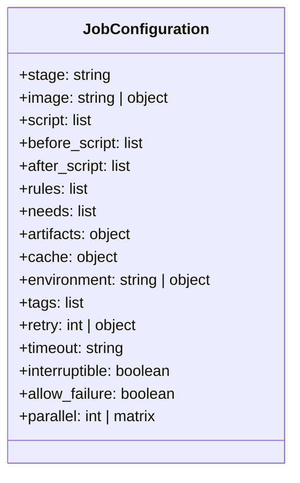

# GitLab CI/CD Cheatsheet & Quick Reference Guide

> အမြန်လှန်လှော ကြည့်ရှုနိုင်သော `.gitlab-ci.yml` Keywords များ၊ Built-in Predefined Variables များနှင့် `glab` CLI Commands များ၏ ပြီးပြည့်စုံသော Quick Reference လက်စွဲဖြစ်ပါသည်။

---

## 1. Top-Level Keywords Reference

| Keyword | ရှင်းလင်းချက် | ဥပမာ |
| :--- | :--- | :--- |
| `stages` | Pipeline တွင် အသုံးပြုမည့် အဆင့်ဆင့်သော Stage အမည်များနှင့် အစဉ်လိုက် စီစဉ်မှု | `stages: [build, test, deploy]` |
| `workflow` | Pipeline တစ်ခုလုံး အလုပ်လုပ်မည်/မလုပ်မည်ကို ထိန်းချုပ်သည့် Global rules | `workflow: rules: [...]` |
| `variables` | Pipeline တစ်ခုလုံးရှိ Job အားလုံးအတွက် Global Environment Variables | `variables: { APP_ENV: "production" }` |
| `default` | Jobs အားလုံးအတွက် Default settings (image, before_script, retry, cache) | `default: image: node:20-alpine` |
| `include` | ပြင်ပ သို့မဟုတ် သီးခြား YAML ဖိုင်များကို modular ပေါင်းစပ်ခေါ်ယူခြင်း | `include: { local: "ci/test.yml" }` |

---

## 2. Job-Level Keywords Reference



| Keyword | အသေးစိတ်ဖော်ပြချက် |
| :--- | :--- |
| `stage` | Job ပြေးမည့် Stage နာမည် (default: `test`) |
| `image` | Job run မည့် Docker container image (ဥပမာ `golang:1.22-alpine`) |
| `script` | Job ၏ အဓိက commands များ (Exit code 0 ဖြစ်မှသာ Success သတ်မှတ်သည်) |
| `before_script` | `script` မစတင်မီ dependencies ပြင်ဆင်ရန် run သော commands များ |
| `after_script` | Job အောင်မြင်သည်ဖြစ်စေ၊ ကျရှုံးသည်ဖြစ်စေ အမြဲတမ်း run မည့် cleanup commands များ |
| `rules` | Job run မည့်/မrun မည့် အခြေအနေကို စစ်ဆေးသည့် modern logic engine |
| `needs` | **DAG Optimization:** Stage sequence ကို ကျော်လွန်၍ တိုက်ရိုက်မှီခိုမည့် Upstream Jobs များ |
| `artifacts` | Stage တစ်ခုမှ ထွက်လာသော Build results များကို GitLab server သို့ သိမ်းဆည်း/လက်ဆင့်ကမ်းခြင်း |
| `cache` | Package dependencies (`node_modules`, `.m2`) များကို နောက်ထပ် pipelines များအတွက် အမြန် restore လုပ်ရန် |
| `environment` | Deploy ပြုလုပ်မည့် ပတ်ဝန်းကျင် (Review apps, staging, production) |
| `tags` | သတ်မှတ်ထားသော Runner tags (ဥပမာ `gpu`, `k8s-runner`, `arm64`) ရှိသည့် Runner ပေါ်တွင်သာ run စေရန် |
| `retry` | Runner ကျခြင်း သို့မဟုတ် script fail ဖြစ်ပါက အလိုအလျောက် ပြန် run ပေးမည့် အကြိမ်အရေအတွက် |
| `timeout` | Job တစ်ခုအတွက် အများဆုံး သတ်မှတ်ထားသော အချိန် (ဥပမာ `30m`, `2h`) |
| `interruptible` | Commit အသစ် ထပ်မံရောက်ရှိလာပါက ယခင် run နေဆဲ Job အဟောင်းကို အလိုအလျောက် cancel လုပ်ပစ်ခြင်း (`true`) |
| `allow_failure` | Job ကျရှုံးသွားသော်လည်း Pipeline ကို ဆက်လက် အလုပ်လုပ်ခွင့်ပြုခြင်း (`true`) |
| `parallel` | Matrix build (OS အမျိုးမျိုး၊ Python versions မျိုးစုံ) သို့မဟုတ် Jobs များကို အပြိုင် ခွဲ run ခြင်း |

---

## 3. Essential Predefined CI/CD Variables

GitLab မှ အလိုအလျောက် inject ပြုလုပ်ပေးသော အရေးကြီးဆုံး Variables များ:

### 3.1 Commit & Branch Information
| Variable Name | နမူနာတန်ဖိုး | အသုံးဝင်ပုံ |
| :--- | :--- | :--- |
| `CI_COMMIT_SHA` | `7b9a528f80456c...` | 40-character Full Git Commit Hash |
| `CI_COMMIT_SHORT_SHA` | `7b9a528f` | 8-character Short SHA (Docker Image Tags အတွက် အကောင်းဆုံး) |
| `CI_COMMIT_BRANCH` | `main`, `feature/auth` | Commit ပြုလုပ်ခဲ့သော Branch နာမည် |
| `CI_COMMIT_TAG` | `v1.2.0` | Commit Tag ပြုလုပ်ခဲ့ပါက Tag နာမည် |
| `CI_DEFAULT_BRANCH` | `main` | Repository ၏ Default Base Branch |
| `CI_COMMIT_REF_SLUG` | `feature-auth` | URL-safe Branch/Tag name (Review app DNS တွင် သုံးသည်) |

### 3.2 Pipeline & Trigger Source
| Variable Name | တန်ဖိုးများ | အဓိပ္ပာယ် |
| :--- | :--- | :--- |
| `CI_PIPELINE_SOURCE` | `push`, `merge_request_event`, `schedule`, `web`, `trigger` | Pipeline စတင်ဖြစ်ပေါ်စေခဲ့သော အကြောင်းရင်း |
| `CI_MERGE_REQUEST_IID`| `42` | Merge Request Number / ID |
| `CI_OPEN_MERGE_REQUESTS`| `my-group/repo!42` | အကယ်၍ လက်ရှိ branch အတွက် MR ဖွင့်ထားပါက ရှိနေသော MR list |

### 3.3 Container Registry & Project
| Variable Name | နမူနာတန်ဖိုး | အသုံးဝင်ပုံ |
| :--- | :--- | :--- |
| `CI_REGISTRY` | `registry.gitlab.com` | GitLab Container Registry Hostname |
| `CI_REGISTRY_IMAGE` | `registry.gitlab.com/group/app` | Current Project ၏ Base Docker Image Path |
| `CI_REGISTRY_USER` | `gitlab-ci-token` | Registry သို့ Push/Pull လုပ်ရန် Predefined Username |
| `CI_REGISTRY_PASSWORD` | `[JWT TOKEN]` | Registry အတွက် Short-lived Access Token |
| `CI_PROJECT_DIR` | `/builds/group/app` | Runner ပေါ်ရှိ Git Repository Cloned Working Directory |

---

## 4. `rules:` Logic Cheatsheet

### 4.1 Common Expressions
```yaml
# Merge Request တွင်သာ Run မည်
rules:
  - if: '$CI_PIPELINE_SOURCE == "merge_request_event"'

# Main Branch တွင်သာ Run မည်
rules:
  - if: '$CI_COMMIT_BRANCH == $CI_DEFAULT_BRANCH'

# Git Tag တင်မှသာ Run မည် (Release Jobs)
rules:
  - if: '$CI_COMMIT_TAG'

# Frontend ဖိုင်များ ပြောင်းလဲမှသာ Run မည်
rules:
  - changes:
      - "frontend/**/*"
      - "package.json"

# Repository ထဲတွင် Dockerfile ရှိမှသာ Run မည်
rules:
  - exists:
      - "Dockerfile"

# Manual Approval ဖြင့်သာ Run မည့် Gate
rules:
  - if: '$CI_COMMIT_BRANCH == "main"'
    when: manual
```

### 4.2 Comparison Operators
- `==` (Equality), `!=` (Inequality)
- `=~` (Regex pattern match), `!~` (Regex pattern non-match)
- `&&` (Logical AND), `||` (Logical OR)

```yaml
# Example: main သို့မဟုတ် develop branch ဖြစ်ပြီး schedule pipeline မဟုတ်လျှင်
rules:
  - if: '($CI_COMMIT_BRANCH == "main" || $CI_COMMIT_BRANCH == "develop") && $CI_PIPELINE_SOURCE != "schedule"'
```

---

## 5. `glab` CLI Cheatsheet (GitLab Official CLI)

Local Terminal မှနေ၍ GitLab CI/CD ကို လွယ်ကူလျင်မြန်စွာ ထိန်းချုပ်နိုင်သော `glab` command များ:

### 5.1 Authentication & Configuration
```bash
# Login to GitLab Cloud or Self-Managed Instance
glab auth login --hostname gitlab.company.com

# Check login status
glab auth status
```

### 5.2 Pipeline Management
```bash
# လက်ရှိ Repository ၏ Pipeline Status ကြည့်ရှုခြင်း
glab ci status

# နောက်ဆုံး Pipeline run နေမှုအား Real-time interactive ကြည့်ရှုခြင်း
glab ci view

# Pipeline အသစ်တစ်ခု manual trigger ပြုလုပ်ခြင်း
glab ci run -b main

# Pipeline အား cancel ပြုလုပ်ခြင်း သို့မဟုတ် retry လုပ်ခြင်း
glab ci cancel <pipeline-id>
glab ci retry <pipeline-id>
```

### 5.3 Job Logs & Linting
```bash
# Job တစ်ခု၏ live terminal log ကို stream ဆွဲကြည့်ခြင်း
glab ci trace <job-name>

# Local ရှိ .gitlab-ci.yml ဖိုင်အား Syntax အမှား/အမှန် စစ်ဆေးခြင်း
glab ci lint
```

### 5.4 CI/CD Variables Management
```bash
# Project ရှိ Variables စာရင်းကြည့်ခြင်း
glab variable list

# Variable အသစ် သတ်မှတ်ခြင်း (Masked & Protected)
glab variable set DB_PASSWORD "supersecret" --masked --protected

# Variable ဖျက်ပစ်ခြင်း
glab variable delete DB_PASSWORD
```

---

## 6. Pro-Tip Architecture Snippet: Optimal Caching Pattern

```yaml
# Ultimate Cache Pattern for Node.js / Java
.cache_template: &standard_cache
  key:
    files:
      - package-lock.json # Lock file ပြောင်းမှ cache အသစ်ဆောက်မည်
  paths:
    - .npm/
    - node_modules/
  policy: pull-push

# Fast Test Job: Read-only Cache with DAG
fast_test:
  image: node:20-alpine
  needs: [] # Run immediately on pipeline start!
  cache:
    <<: *standard_cache
    policy: pull # Only read, never waste time uploading cache!
  script:
    - npm ci --prefer-offline --cache .npm
    - npm test
```
