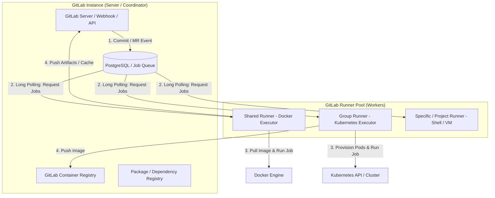
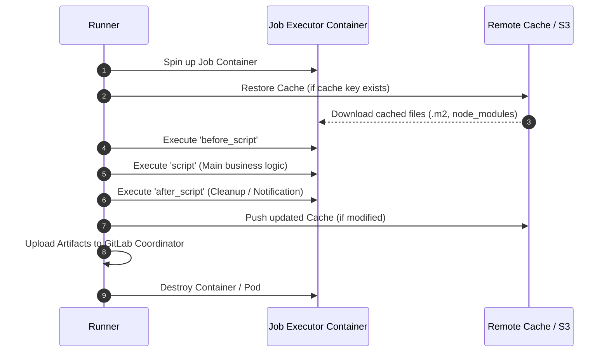
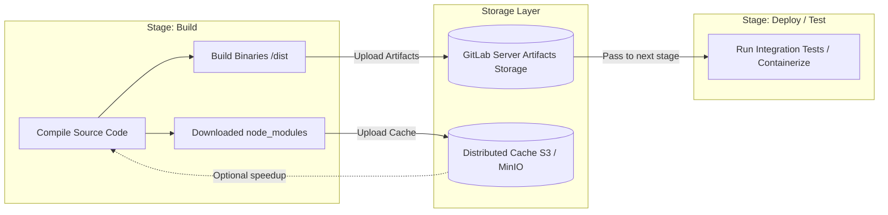

# Lesson 1: GitLab CI/CD Architecture & Core Fundamentals

> **Objective:** GitLab CI/CD ၏ Core Architecture (Coordinator vs Runners, Executor Types) ကို နားလည်သဘောပေါက်ပြီး Basic Pipeline structure (stages, jobs, scripts) နှင့် CI/CD Optimization အတွက် အရေးကြီးဆုံးဖြစ်သော **Artifacts vs Cache** ကွာခြားချက်များကို လက်တွေ့အသုံးချနိုင်စေရန်။

---

## 1. GitLab CI/CD High-Level Architecture

GitLab CI/CD သည် **Master-Agent (Coordinator-Worker)** Architecture ပေါ်တွင် အခြေခံထားပါသည်။



### 1.1 Coordinator (GitLab Server)
- `.gitlab-ci.yml` file ကို parse လုပ်ပြီး Pipeline, Stages နှင့် Jobs များကို State Machine အနေဖြင့် စီမံခန့်ခွဲပါသည်။
- Runner များထံသို့ Build Token များထုတ်ပေးခြင်း၊ Job queue များစီစဉ်ပေးခြင်းနှင့် Job status (running, success, failed) များကို Database ထဲတွင် သိမ်းဆည်းပါသည်။
- Web UI ပေါ်တွင် Real-time build logs များကို stream ပြသပေးပါသည်။

### 1.2 GitLab Runners (Execution Workers)
GitLab Runner သည် Go language ဖြင့် ရေးသားထားသော open-source application ဖြစ်ပြီး Server ထံမှ jobs များကို polling လုပ်ယူကာ သတ်မှတ်ထားသော environment (Docker, K8s, VM) ပေါ်တွင် run ပေးပါသည်။

#### Runner Scope Types:
1. **Shared Runners (Instance Runners):** 
   - GitLab Instance တစ်ခုလုံးရှိ Project အားလုံး အသုံးပြုနိုင်သော Runners များဖြစ်ပါသည်။
   - Organization-wide build infrastructure တွင် CPU/RAM cost ချွေတာရန် အသုံးပြုပါသည်။
2. **Group Runners:**
   - သက်ဆိုင်ရာ GitLab Group / Subgroup အောက်ရှိ Repositories များသာ မျှဝေသုံးစွဲနိုင်ပါသည်။
   - Team-level သီးသန့် compute quota သတ်မှတ်လိုသောအခါ သုံးပါသည်။
3. **Specific Runners (Project Runners):**
   - Single project တစ်ခုတည်းအတွက်သာ Register လုပ်ထားသော Runners ဖြစ်ပါသည်။
   - High-security requirements ရှိသော finance/payment microservices သို့မဟုတ် On-Premise Hardware/GPU လိုအပ်သော AI/ML build များအတွက် မဖြစ်မနေ သုံးသင့်ပါသည်။

---

## 2. GitLab Runner Executors နှိုင်းယှဉ်ချက်

Runner တစ်ခုစီတွင် Job ကို မည်သည့် environment ၌ run မည်ကို သတ်မှတ်ပေးသည့် **Executor** ရှိပါသည်။

| Executor | Isolation Level | Setup Complexity | Speed | Best For |
| :--- | :--- | :--- | :--- | :--- |
| **Shell** | ❌ Low (Host OS တိုက်ရိုက်) | အလွန်လွယ်ကူသည် | အလွန်မြန်သည် | Simple scripts, local testing, Legacy bare-metal builds |
| **Docker** | ⚠️ Medium (Container Level) | အလယ်အလတ် | မြန်သည် | General CI pipelines, Standard Microservices |
| **Kubernetes** | ✅ High (Ephemeral Pods) | ရှုပ်ထွေးသည် (K8s Cluster လိုအပ်) | Dynamic Autoscaling ဖြစ်၍ အကောင်းဆုံး | Enterprise Auto-scaling, Multi-tenant, Cloud-native CI/CD |
| **VirtualBox / Parallels** | 🛡️ Maximum (VM Level) | မြင့်မားသည် | နှေးသည် | OS-level testing, Security sandbox |

> [!IMPORTANT]
> **Production Best Practice:** 
> Enterprise Cloud-Native Platform များတွင် **Kubernetes Executor** ကို Runner Manager အဖြစ် အသုံးပြုကြပါသည်။ Pipeline job တစ်ခု run တိုင်း K8s Pod အသစ် auto-create ဖြစ်ပြီး Job ပြီးဆုံးပါက Pod ကို terminate လုပ်ပစ်သောကြောင့် Zero-Artifact Pollution နှင့် High Security Isolation ကို ရရှိစေပါသည်။

---

## 3. Basic Pipeline Structure: Stages, Jobs & Script Hooks

GitLab CI/CD Pipeline ၏ အခြေခံယူနစ်မှာ `Job` ဖြစ်ပြီး Job များကို `stages` ဖြင့် အစဉ်လိုက် စီတန်းထားပါသည်။



### Script Hooks ၏ အလုပ်လုပ်ပုံ:
- `before_script`: Main script မ run မီ လိုအပ်သော dependencies install လုပ်ခြင်း၊ environment variable ပြင်ဆင်ခြင်း၊ Database migrate စစ်ဆေးခြင်း စသည်တို့ကို လုပ်ဆောင်ပါသည်။
- `script`: Job ၏ အဓိက commands များ (build, test, compile, package) ဖြစ်ပါသည်။ Exit code non-zero (1..255) ဖြစ်ပါက Job ကို `failed` အဖြစ် သတ်မှတ်ပြီး pipeline ရပ်တန့်သွားပါသည်။
- `after_script`: Main script အောင်မြင်သည်ဖြစ်စေ၊ ကျရှုံးသည်ဖြစ်စေ အမြဲတမ်း run ပါသည်။ Cleanup tasks, Slack notification ပို့ခြင်း သို့မဟုတ် Diagnostic logs ထုတ်ယူခြင်းအတွက် သုံးပါသည်။

> [!WARNING]
> `after_script` သည် သီးခြား sub-shell session တစ်ခုတွင် run သောကြောင့် `before_script` သို့မဟုတ် `script` ထဲတွင် export လုပ်ခဲ့သော shell variables များကို `after_script` ထဲတွင် တိုက်ရိုက်ခေါ်သုံး၍ မရနိုင်ပါ။

---

## 4. Deep Dive: Artifacts vs Cache

DevOps အင်ဂျင်နီယာအများစု မှားယွင်းစွာ အသုံးပြုလေ့ရှိသည့် အဓိကအချက်မှာ `artifacts` နှင့် `cache` ၏ သဘောတရားကို ရောထွေးခြင်း ဖြစ်ပါသည်။



### အဓိက ကွာခြားချက် နှိုင်းယှဉ်ချက်ဇယား

| Parameters | `artifacts` (Output of a job) | `cache` (Dependencies speedup) |
| :--- | :--- | :--- |
| **ရည်ရွယ်ချက်** | Stage တစ်ခုမှ ထွက်လာသော ရလဒ် (Binaries, Test reports, jar file) ကို နောက် Stage သို့ လက်ဆင့်ကမ်းရန် | Package dependencies (`node_modules`, Maven `.m2`, pip cache) ကို နောက်ထပ် pipeline များအတွက် ပြန်သုံးပြီး Build time လျှော့ချရန် |
| **Pass Across Stages?** | ✅ Stages ကြား အပြန်အလှန် ပို့ဆောင်နိုင်သည် (Build -> Test -> Deploy) | ⚠️ Stages ကြား ပို့ရန် မရည်ရွယ်ပါ။ Pipelines အချင်းချင်း (Runs) ကြားတွင်သာ အဓိက reuse လုပ်သည် |
| **Download Behavior** | Default အားဖြင့် နောက် Stage ရှိ Jobs အားလုံး auto-download လုပ်သည် | Job config တွင် `cache:` key သတ်မှတ်ထားမှသာ download လုပ်သည် |
| **Reliability** | **Guaranteed Delivery** (Download မရပါက error ဖြစ်သည်) | **Best-effort** (Cache miss ဖြစ်လျှင် package ကို re-download လုပ်နိုင်ရမည်) |
| **Storage Location** | GitLab Coordinator Server (သို့မဟုတ် GitLab configured storage) | GitLab Runner Cache (S3, MinIO, GCP GCS bucket) |
| **Expiration** | `expire_in` ဖြင့် အချိန်သတ်မှတ်နိုင်သည် (ဥပမာ `1 week`, `30 days`) | Cache server ပေါ်ရှိ Retention policy အတိုင်း သိမ်းဆည်းသည် |

---

## 5. Production Ready `.gitlab-ci.yml` ဥပမာ

အောက်ပါ configuration သည် Node.js Microservice တစ်ခုအတွက် `before_script`, `after_script`, `cache` နှင့် `artifacts` များကို Enterprise standard အတိုင်း ရေးသားထားသော ဥပမာဖြစ်ပါသည်။

```yaml
# ==============================================================================
# Production Pipeline: Node.js Microservice with Proper Caching & Artifacts
# ==============================================================================

stages:
  - dependencies
  - test
  - build
  - package

default:
  image: node:20-alpine
  # Global before_script - Base system checks
  before_script:
    - node -v
    - npm -v

# Global Cache Definition (Branch-based caching)
cache:
  key:
    files:
      - package-lock.json
  paths:
    - .npm/
    - node_modules/
  policy: pull

# ------------------------------------------------------------------------------
# 1. Dependency Installation Job
# ------------------------------------------------------------------------------
install_deps:
  stage: dependencies
  cache:
    key:
      files:
        - package-lock.json
    paths:
      - .npm/
      - node_modules/
    policy: pull-push # package-lock.json ပြောင်းလဲမှသာ Cache သစ်ကို push လုပ်မည်
  script:
    - npm ci --cache .npm --prefer-offline
  rules:
    - if: '$CI_PIPELINE_SOURCE == "merge_request_event"'
    - if: '$CI_COMMIT_BRANCH == "main"'

# ------------------------------------------------------------------------------
# 2. Automated Testing Job (Uses Cache)
# ------------------------------------------------------------------------------
unit_test:
  stage: test
  script:
    - npm test -- --coverage
  after_script:
    - echo "Testing completed for Commit SHA: $CI_COMMIT_SHA"
  artifacts:
    name: "coverage-report-$CI_COMMIT_REF_SLUG"
    when: always # Test ကျရှုံးခဲ့လျှင်လည်း coverage report ကို download ဆွဲစစ်ဆေးနိုင်ရန်
    expire_in: 7 days
    reports:
      junit: junit.xml
      coverage_report:
        coverage_format: cobertura
        path: coverage/cobertura-coverage.xml
    paths:
      - coverage/

# ------------------------------------------------------------------------------
# 3. Production Build Job (Generates Deployable Artifacts)
# ------------------------------------------------------------------------------
build_dist:
  stage: build
  script:
    - npm run build
  artifacts:
    name: "dist-artifacts-$CI_COMMIT_SHORT_SHA"
    expire_in: 14 days
    paths:
      - dist/
    exclude:
      - dist/*.map # Source map file များကို security ကြောင့် ချန်လှပ်ခဲ့ခြင်း

# ------------------------------------------------------------------------------
# 4. Packaging Job (Consumes Artifacts from Build Stage)
# ------------------------------------------------------------------------------
package_info:
  stage: package
  dependencies:
    - build_dist # build_dist job ထံမှ dist/ artifacts ကိုသာ ရွေးချယ် download လုပ်မည်
  script:
    - ls -la dist/
    - echo "Packaged application successfully from dist folder"
```

---

## 6. Key Takeaways & Troubleshooting Tips

> [!TIP]
> 1. **Cache Key Naming Best Practice:** `key: { files: [package-lock.json, pom.xml, go.sum] }` ပုံစံကို သုံးပါ။ Dependency file များ ပြောင်းလဲမှုမရှိသရွေ့ runner သည် cache အဟောင်းကို instant restore လုပ်နိုင်သောကြောင့် Build time ကို ၆၀% မှ ၈၀% အထိ လျှော့ချပေးနိုင်ပါသည်။
> 2. **Pull-Push Policy Optimization:** Routine jobs (Test, Lint) များတွင် `policy: pull` ကိုသာသုံးပါ။ Cache ကို အသစ် upload ပြန်မတင်စေခြင်းဖြင့် Runner network I/O bandwidth ကို သက်သာစေပါသည်။
> 3. **`dependencies:` Keyword ကို အသုံးချပါ:** Job တစ်ခုသည် ယခင် stages အားလုံးမှ artifacts များကို default အားဖြင့် download ဆွဲလေ့ရှိပါသည်။ လိုအပ်သော Job နာမည်ကိုသာ `dependencies: [build_job]` ဟု ရွေးထုတ်ပေးခြင်းဖြင့် disk space နှင့် job startup latency ကို သက်သာစေပါသည်။
