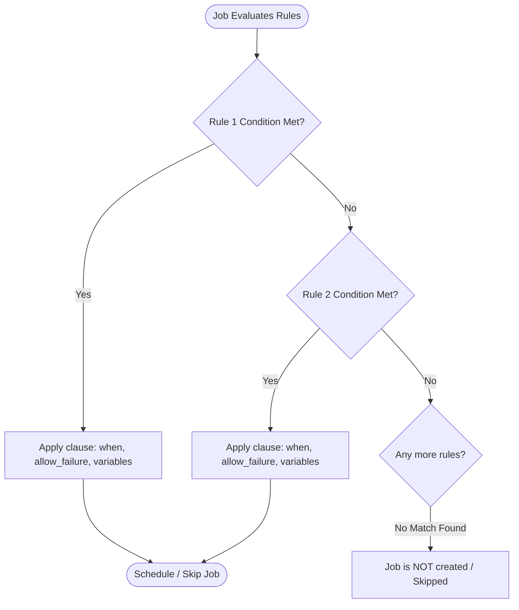
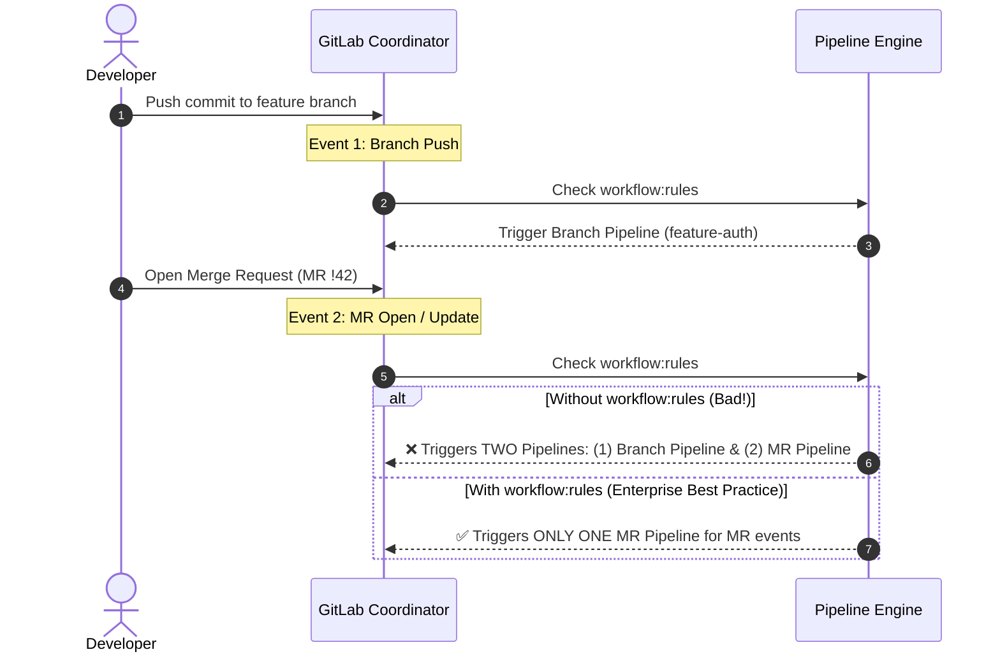
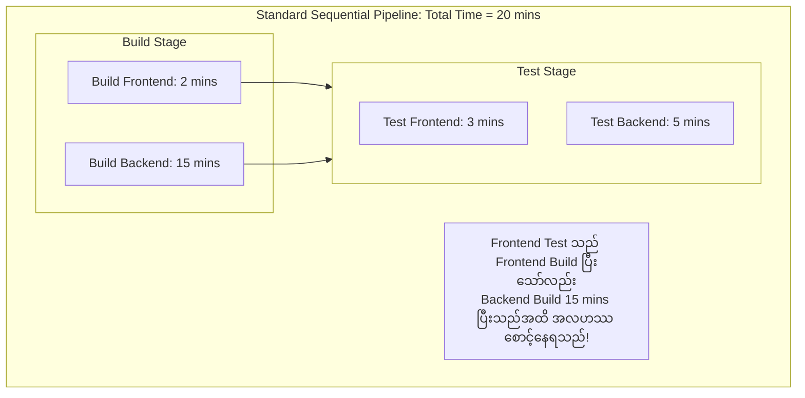

# Lesson 2: Modern Control Flow & Pipeline Optimization

> **Objective:** GitLab CI/CD တွင် Legacy `only/except` syntax အစား ခေတ်မီ `rules` engine ကို ကျွမ်းကျင်စွာ အသုံးပြုနိုင်စေရန်၊ `workflow:rules` ဖြင့် Duplicate Pipelines (Double Pipeline Trigger) ပြဿနာကို ဖြေရှင်းရန်နှင့် **Directed Acyclic Graph (DAG) `needs:`** ဖြင့် Stage အလိုက် စောင့်ဆိုင်းရသော Bottlenecks များကို ဖယ်ရှားကာ Pipeline အမြန်နှုန်းကို အဆမတန် မြှင့်တင်ရန်။

---

## 1. Modern Control Flow: The `rules:` Syntax

GitLab 12.3 မှစတင်၍ `only/except` syntax ကို deprecated လုပ်ခဲ့ပြီး ပိုမိုပြည့်စုံသော `rules` engine ဖြင့် အစားထိုးခဲ့ပါသည်။ `rules` သည် list-based evaluation ဖြစ်ပြီး **First Match Wins** မူဝါဒဖြင့် အလုပ်လုပ်ပါသည်။



### 1.1 အဓိက Rules Conditions များ

| Clause | ဖော်ပြချက် | လက်တွေ့အသုံးချမှု ဥပမာ |
| :--- | :--- | :--- |
| `rules:if` | Environment variables သို့မဟုတ် Predefined CI variables များကို စစ်ဆေးခြင်း | `$CI_COMMIT_BRANCH == $CI_DEFAULT_BRANCH` |
| `rules:changes` | Git diff တွင် သတ်မှတ်ထားသော ဖိုင် သို့မဟုတ် Folder များ ပြောင်းလဲမှုရှိမရှိ စစ်ဆေးခြင်း | Frontend directory ပြောင်းလဲမှ Frontend build job ကို run ရန် |
| `rules:exists` | Repository root ထဲတွင် သတ်မှတ်ထားသော ဖိုင်တည်ရှိမှု ရှိမရှိ စစ်ဆေးခြင်း | `Dockerfile` ရှိမှသာ Docker build job ကို run ရန် |
| `when:` | Job run မည့် အချိန်နှင့် အပြုအမူကို သတ်မှတ်ခြင်း | `on_success`, `manual`, `never`, `always`, `delayed` |
| `allow_failure:` | Job ကျရှုံးသွားသော်လည်း Pipeline ကို ဆက်လက်လည်ပတ်ခွင့်ပြုခြင်း | Security audit သို့မဟုတ် Experimental test jobs များအတွက် |

> [!CAUTION]
> **Important Rules Logic:**
> `rules:` array အတွင်းရှိ conditions များကို အပေါ်မှအောက်သို့ အစဉ်လိုက်စစ်ဆေးပြီး တစ်ခုခုကိုက်ညီပါက နောက်ထပ် rule များကို ဆက်လက်မစစ်ဆေးတော့ပါ။ ထို့ကြောင့် **Specific conditions (ဥပမာ `when: never`) များကို အပေါ်ဆုံးတွင်ထားပြီး Generic conditions များကို အောက်ဆုံးတွင် ထားရပါမည်**။

---

## 2. Preventing Duplicate Pipelines with `workflow:rules`

အဖွဲ့အစည်းများတွင် အဖြစ်အများဆုံး ပြဿနာတစ်ခုမှာ Merge Request (MR) ဖွင့်လိုက်သည့်အခါ Branch Pipeline နှင့် Merge Request Pipeline နှစ်ခုစလုံး ပြိုင်တူ trigger ဖြစ်ကာ Runner resources များကို ၂ ဆ အလဟဿ ကုန်ဆုံးစေခြင်း ဖြစ်ပါသည်။



### Standard `workflow:rules` Template:
```yaml
# Pipeline တစ်ခုလုံးအတွက် Global Trigger Rules
workflow:
  rules:
    # 1. Merge Request ဖွင့်ထားသော Branch ဖြစ်ပါက MR Pipeline ကိုသာ Run မည်
    - if: '$CI_PIPELINE_SOURCE == "merge_request_event"'
    # 2. MR မဖွင့်ထားသေးသော Feature branch ဖြစ်ပြီး commit push တိုင်း run မည် (optional)
    - if: '$CI_OPEN_MERGE_REQUESTS'
      when: never
    # 3. Default branch (main/master) နှင့် tags များတွင် commit တင်ပါက Branch Pipeline run မည်
    - if: '$CI_COMMIT_BRANCH == $CI_DEFAULT_BRANCH'
    - if: '$CI_COMMIT_TAG'
```

---

## 3. Directed Acyclic Graph (DAG) with `needs:`

ရိုးရိုး Standard Pipeline များတွင် Stage တစ်ခုလုံးရှိ Jobs များ အားလုံးပြီးစီးမှသာ နောက်ထပ် Stage သို့ ကူးပြောင်းနိုင်ပါသည်။ ၎င်းသည် **Sequential Bottleneck** ကို ဖြစ်ပေါ်စေပါသည်။

### 3.1 Sequential Pipeline vs DAG Pipeline နှိုင်းယှဉ်ချက်



```mermaid
flowchart TD
    subgraph DAG [DAG Pipeline with needs: Total Time = 15 mins]
        direction LR
        D_B_FE[Build Frontend: 2m] -->|needs: [build-frontend]| D_T_FE[Test Frontend: 3m]
        D_B_BE[Build Backend: 10m] -->|needs: [build-backend]| D_T_BE[Test Backend: 5m]
        note2[Frontend Test သည် Stage မပြီးမီ ချက်ချင်းစတင်နိုင်သောကြောင့်<br/>Frontend Pipeline သည် ၅ မိနစ်အတွင်း အပြီးသတ်သည်!]
    end
```

### 3.2 `needs:` ၏ အဓိက စွမ်းဆောင်ရည်များ:
1. **Out-of-Order Execution:** သတ်မှတ်ထားသော Dependency job ပြီးသည်နှင့် Stage မခွဲခြားဘဲ ချက်ချင်း run နိုင်ပါသည်။
2. **Selective Artifacts Download:** `needs: [job_name]` ကို အသုံးပြုပါက သတ်မှတ်ထားသော job ထံမှ artifacts ကိုသာ ဒေါင်းလုဒ်ဆွဲသောကြောင့် network transfer time ကို သက်သာစေပါသည်။
3. **Cross-Project Dependencies:** GitLab Premium/Ultimate တွင် အခြား project ရှိ upstream pipeline များကိုပင် `needs:project` ဖြင့် ချိတ်ဆက်နိုင်ပါသည်။

---

## 4. Production Grade Pipeline: Monorepo Microservices with DAG & Rules

အောက်ပါ configuration သည် Frontend (React) နှင့် Backend (Go API) နှစ်ခုပါဝင်သော Monorepo ပရောဂျက်တစ်ခုအတွက် ရေးသားထားသော Production Pipeline ဖြစ်ပါသည်။

```yaml
# ==============================================================================
# Production Pipeline: Monorepo DAG with Advanced Rules & Optimization
# ==============================================================================

stages:
  - lint
  - build
  - test
  - deploy

# ------------------------------------------------------------------------------
# Global Workflow Rules: Double Pipeline ကာကွယ်ခြင်း
# ------------------------------------------------------------------------------
workflow:
  rules:
    - if: '$CI_PIPELINE_SOURCE == "merge_request_event"'
    - if: '$CI_COMMIT_BRANCH && $CI_OPEN_MERGE_REQUESTS'
      when: never
    - if: '$CI_COMMIT_BRANCH == $CI_DEFAULT_BRANCH'
    - if: '$CI_COMMIT_TAG'

# ==============================================================================
# Stage: Lint (Parallel execution)
# ==============================================================================
lint:frontend:
  stage: lint
  image: node:20-alpine
  rules:
    - changes:
        - "frontend/**/*"
  script:
    - cd frontend
    - npm ci
    - npm run lint

lint:backend:
  stage: lint
  image: golang:1.22-alpine
  rules:
    - changes:
        - "backend/**/*"
  script:
    - cd backend
    - go vet ./...

# ==============================================================================
# Stage: Build
# ==============================================================================
build:frontend:
  stage: build
  image: node:20-alpine
  rules:
    - changes:
        - "frontend/**/*"
  script:
    - cd frontend
    - npm ci
    - npm run build
  artifacts:
    name: "fe-dist-$CI_COMMIT_SHORT_SHA"
    expire_in: 3 days
    paths:
      - frontend/dist/

build:backend:
  stage: build
  image: golang:1.22-alpine
  rules:
    - changes:
        - "backend/**/*"
  script:
    - cd backend
    - CGO_ENABLED=0 go build -o bin/api main.go
  artifacts:
    name: "be-bin-$CI_COMMIT_SHORT_SHA"
    expire_in: 3 days
    paths:
      - backend/bin/api

# ==============================================================================
# Stage: Test (DAG Needs Optimization)
# ==============================================================================
test:frontend:
  stage: test
  image: node:20-alpine
  needs:
    - job: build:frontend
      artifacts: true # build:frontend ပြီးသည်နှင့် backend build ကို စောင့်စရာမလိုဘဲ ချက်ချင်း run မည်
  rules:
    - changes:
        - "frontend/**/*"
  script:
    - cd frontend
    - npm test

test:backend:
  stage: test
  image: golang:1.22-alpine
  needs:
    - job: build:backend
      artifacts: true
  rules:
    - changes:
        - "backend/**/*"
  script:
    - cd backend
    - go test -v -race ./...

# ==============================================================================
# Stage: Deploy (Conditional Manual Gate)
# ==============================================================================
deploy:staging:
  stage: deploy
  image: alpine/k8s:1.29.2
  needs:
    - job: test:frontend
      optional: true # frontend ပြောင်းလဲမှုမရှိ၍ test:frontend မ run လျှင်လည်း deploy ဆက်လုပ်မည်
    - job: test:backend
      optional: true
  rules:
    # Main branch ပေါ်သို့ merge ပြီးပါက auto deploy လုပ်မည်
    - if: '$CI_COMMIT_BRANCH == $CI_DEFAULT_BRANCH'
      when: on_success
    # Feature branch များတွင် manual စမ်းသပ်လိုပါက ခွင့်ပြုမည်
    - if: '$CI_PIPELINE_SOURCE == "merge_request_event"'
      when: manual
      allow_failure: true
  script:
    - echo "Deploying artifacts to Kubernetes Staging Cluster..."
    - kubectl get pods -n staging
```

---

## 5. Architectural Recommendations & Best Practices

> [!TIP]
> 1. **Use `needs: []` for Independent Jobs:** Linting သို့မဟုတ် SAST Security scan ကဲ့သို့သော jobs များသည် build artifacts ပေါ် မှီခိုခြင်းမရှိပါ။ ထို့ကြောင့် `needs: []` (empty array) သတ်မှတ်ပေးပါက Pipeline စတင်သည်နှင့် ပထမဆုံး stage ပြီးသည်ကို မစောင့်ဘဲ zero-second latency ဖြင့် အပြိုင် (parallel) ချက်ချင်း run သွားပါမည်။
> 2. **`rules:changes:compare_to` for MR Reliability:** Merge Request များတွင် default အားဖြင့် branch commit အချင်းချင်း compare လုပ်ပါသည်။ Target branch (main) နှင့် တိကျစွာ compare လုပ်လိုပါက:
>    ```yaml
>    rules:
>      - changes:
>          paths:
>            - "backend/**/*"
>          compare_to: 'refs/heads/main'
>    ```
> 3. **Avoid Mixing `only/except` with `rules`:** Pipeline တစ်ခုတည်းတွင် `only` နှင့် `rules` ကို ရောထွေးသုံးပါက GitLab Linter မှ error ပေးနိုင်သလို unpredictable job behavior ဖြစ်ပေါ်စေပါသည်။
