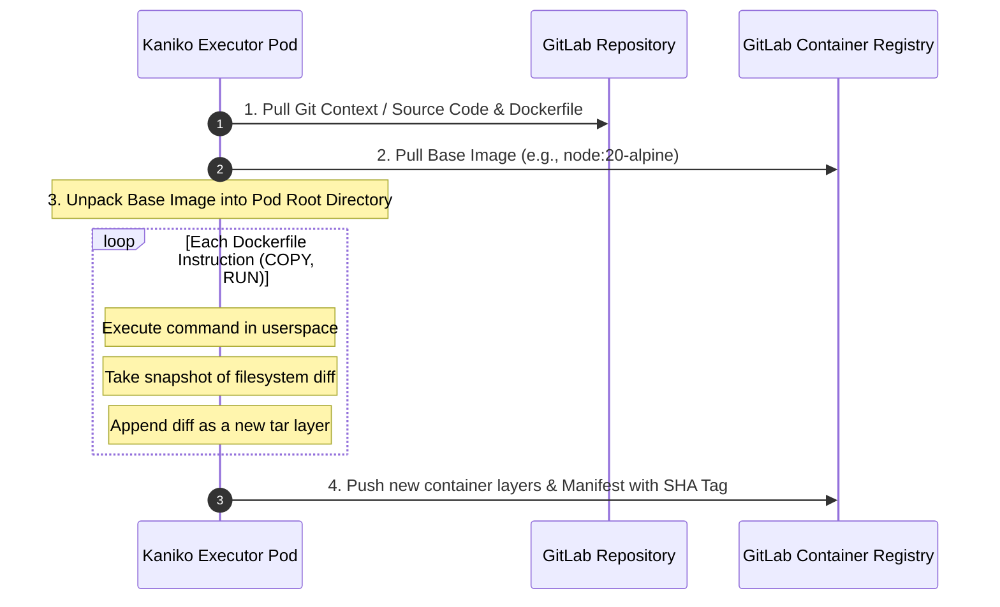

# Lesson 3: Secure Container Image Building with Kaniko

> **Objective:** Kubernetes-based GitLab Runner များပေါ်တွင် Docker-in-Docker (`dind`) အသုံးပြုခြင်း၏ ကြီးမားသော လုံခြုံရေးပြဿနာများကို နားလည်သဘောပေါက်စေရန်နှင့် Rootless / Unprivileged Container Image Builder ဖြစ်သော **Google Kaniko** ကို အသုံးပြု၍ GitLab Container Registry သို့ Multi-stage Docker Images များကို Secure & High-Performance နည်းလမ်းဖြင့် တည်ဆောက်နည်းကို ကျွမ်းကျင်စေရန်။

---

## 1. Why Docker-in-Docker (DinD) is Insecure on Kubernetes Runners

သမားရိုးကျ GitLab CI တွင် Docker image တည်ဆောက်ရန် Docker-in-Docker (`docker:dind` service) သို့မဟုတ် Host Docker Socket (`/var/run/docker.sock`) mount ပြုလုပ်ခြင်းကို အသုံးပြုလေ့ရှိကြပါသည်။ သို့သော် Kubernetes Runner များပေါ်တွင် ဤနည်းလမ်းသည် **ဆိုးရွားသော Security Vulnerability (Cluster Takeover Risk)** ကို ဖန်တီးပေးပါသည်။

```mermaid
flowchart TD
    subgraph DinD [Docker-in-Docker Security Flaw: High Vulnerability]
        Pod1[CI Runner Pod] -->|Requires| PrivFlag["privileged: true (Full Root Access)"]
        PrivFlag -->|Access to| HostKernel[Host Node Linux Kernel / Devices]
        HostKernel -->|Attacker can escape| HostRoot[Host Node Root Compromise & Cluster Takeover!]
    end

    subgraph Kaniko [Google Kaniko Architecture: Zero Privilege]
        Pod2[Kaniko Pod] -->|Runs in| UserSpace["Unprivileged Container (privileged: false)"]
        UserSpace -->|Builds inside| RootFS[Isolated Snapshot Filesystem in Userspace]
        RootFS -->|Push directly to| Registry[GitLab Container Registry over HTTPS]
    end
```



### DinD နှင့် Host Socket Mount ၏ အန္တရာယ်များ:
1. **`privileged: true` Required:** DinD သည် Linux kernel capability အားလုံးနီးပါးကို ဖွင့်ပေးရသောကြောင့် CI script ထဲမှ malicious code တစ်ခုသည် Host K8s Node တစ်ခုလုံးကို Breakout (Node Escape) လုပ်ကာ Cluster တစ်ခုလုံးရှိ Secrets များကို ခိုးယူနိုင်ပါသည်။
2. **Docker-in-Docker Cache Inefficiency:** Job pod တစ်ခုစီသည် သီးခြား ephemeral Docker daemon ကို run သောကြောင့် layer cache များ အလွယ်တကူ ပျောက်ဆုံးပြီး build time ကြာမြင့်စေပါသည်။
3. **Containerd / CRI-O Runtime Incompatibility:** ခေတ်မီ Kubernetes (v1.24+) များသည် Docker shim ကို ဖယ်ရှားပြီး Containerd ကို default သုံးထားသောကြောင့် Host docker socket mount လုပ်ခြင်းသည် အလုပ်မလုပ်နိုင်တော့ပါ။

---

## 2. Google Kaniko ၏ လုပ်ဆောင်ချက် သဘောတရား

**Kaniko** သည် Google မှ ထုတ်လုပ်ထားသော tool ဖြစ်ပြီး **Docker daemon မလိုအပ်ဘဲ (Daemonless)** Container သို့မဟုတ် Kubernetes Pod ၏ Userspace အတွင်း Dockerfile ကို တိုက်ရိုက် build လုပ်ပေးနိုင်ပါသည်။



### Kaniko ၏ အားသာချက်များ:
- **No Root / No Daemon:** K8s Pod တွင် `securityContext.privileged: false` ဖြင့် အပြည့်အဝ run နိုင်ပါသည်။ CIS Benchmark နှင့် SOC2 Compliance ကို ကိုက်ညီစေပါသည်။
- **Layer Caching Support:** `--cache=true` flag ကို ထည့်သွင်းရုံဖြင့် Registry ပေါ်တွင် build cache layers များကို remote သိမ်းဆည်းပေးနိုင်ပါသည်။
- **Clean Environment:** Build ပြီးဆုံးပါက Pod ပျက်သွားသောကြောင့် dangling images သို့မဟုတ် disk space leak ဖြစ်ခြင်း မရှိတော့ပါ။

---

## 3. Sample Multi-Stage Dockerfile

Image အရွယ်အစားကို အသေးဆုံးဖြစ်စေရန်နှင့် Vulnerabilities နည်းပါးစေရန် Multi-stage build ကို မဖြစ်မနေ သုံးသင့်ပါသည်။

```dockerfile
# ------------------------------------------------------------------------------
# Stage 1: Build & Compile
# ------------------------------------------------------------------------------
FROM golang:1.22-alpine AS builder

WORKDIR /app

# Download dependencies
COPY go.mod go.sum ./
RUN go mod download

# Copy source and build binary
COPY . .
RUN CGO_ENABLED=0 GOOS=linux go build -ldflags="-w -s" -o /app/server .

# ------------------------------------------------------------------------------
# Stage 2: Minimal Distroless Runtime
# ------------------------------------------------------------------------------
FROM gcr.io/distroless/static-debian12:nonroot

WORKDIR /app
COPY --from=builder /app/server /app/server

USER nonroot:nonroot
EXPOSE 8080

ENTRYPOINT ["/app/server"]
```

---

## 4. Production-Ready GitLab CI Configuration with Kaniko

အောက်ပါ `.gitlab-ci.yml` သည် Kaniko Executor Debug image ကို အသုံးပြု၍ GitLab Container Registry သို့ လုံခြုံစွာ authenticate လုပ်ကာ Layer Cache ဖြင့် တည်ဆောက်ထားသော Production Pipeline ဖြစ်ပါသည်။

```yaml
# ==============================================================================
# Production Pipeline: Rootless Container Build with Google Kaniko
# ==============================================================================

stages:
  - build-image

variables:
  # Container Registry Target Image Path
  IMAGE_NAME: "$CI_REGISTRY_IMAGE/api-service"
  # Kaniko version
  KANIKO_VERSION: "v1.20.0-debug"

# ------------------------------------------------------------------------------
# Kaniko Container Build Job
# ------------------------------------------------------------------------------
build:container:
  stage: build-image
  # Kaniko debug image တွင် busybox shell ပါဝင်သောကြောင့် script runs နိုင်သည်
  image:
    name: gcr.io/kaniko-project/executor:${KANIKO_VERSION}
    entrypoint: [""]
  before_script:
    # GitLab Container Registry အတွက် Auth Config ဖန်တီးခြင်း
    - mkdir -p /kaniko/.docker
    - echo "{\"auths\":{\"$CI_REGISTRY\":{\"username\":\"$CI_REGISTRY_USER\",\"password\":\"$CI_REGISTRY_PASSWORD\"}}}" > /kaniko/.docker/config.json
  script:
    - echo "Building and pushing container image with Kaniko..."
    - >-
      /kaniko/executor
      --context "${CI_PROJECT_DIR}"
      --dockerfile "${CI_PROJECT_DIR}/Dockerfile"
      --destination "${IMAGE_NAME}:${CI_COMMIT_SHORT_SHA}"
      --destination "${IMAGE_NAME}:${CI_COMMIT_REF_SLUG}"
      --cache=true
      --cache-copy-layers=true
      --cache-repo="${IMAGE_NAME}/cache"
      --compressed-caching=false
  rules:
    # Merge Requests များတွင် dry-run (no-push) သာ ပြုလုပ်လိုပါက
    - if: '$CI_PIPELINE_SOURCE == "merge_request_event"'
      variables:
        KANIKO_EXTRA_ARGS: "--no-push"
    # Default branch ပေါ်သို့ merge ပြီးပါက Registry သို့ Push လုပ်မည်
    - if: '$CI_COMMIT_BRANCH == $CI_DEFAULT_BRANCH'
    # Git Tag တင်ပါက Tag name ဖြင့်ပါ Push လုပ်မည်
    - if: '$CI_COMMIT_TAG'
      script:
        - mkdir -p /kaniko/.docker
        - echo "{\"auths\":{\"$CI_REGISTRY\":{\"username\":\"$CI_REGISTRY_USER\",\"password\":\"$CI_REGISTRY_PASSWORD\"}}}" > /kaniko/.docker/config.json
        - >-
          /kaniko/executor
          --context "${CI_PROJECT_DIR}"
          --dockerfile "${CI_PROJECT_DIR}/Dockerfile"
          --destination "${IMAGE_NAME}:${CI_COMMIT_TAG}"
          --destination "${IMAGE_NAME}:latest"
          --cache=true
          --cache-repo="${IMAGE_NAME}/cache"
```

---

## 5. Kaniko Flags Deep-Dive & Performance Optimization

| Kaniko Flag | ရှင်းလင်းချက် | Performance / Security Impact |
| :--- | :--- | :--- |
| `--cache=true` | Layer caching ကို ဖွင့်ပေးသည် | Base image များနှင့် package install အဆင့်များကို re-download မလုပ်ဘဲ build time ကို ၇၀% အထိ မြန်ဆန်စေသည် |
| `--cache-repo` | Remote cache layers များကို သီးခြား repository path တွင် သိမ်းဆည်းသည် | Production image registry tags များနှင့် မရောထွေးစေဘဲ သပ်ရပ်စေသည် |
| `--cache-copy-layers=true` | `COPY` commands များ၏ diff ကိုပါ cache လုပ်ပေးသည် | Source code မပြောင်းလဲသော sub-modules များအတွက် အလွန်မြန်စေသည် |
| `--compressed-caching=false` | Cache layers များကို compress လုပ်သည့် CPU overhead ကို လျှော့ချသည် | Runner ပေါ်တွင် CPU intensive ဖြစ်မှုကို လျှော့ချပေးသည် |
| `--no-push` | Image ကို registry သို့ push မလုပ်ဘဲ build process ကိုသာ စမ်းသပ်သည် | PR / MR verification pipelines များအတွက် အသင့်တော်ဆုံး ဖြစ်သည် |

> [!TIP]
> **Distroless Runtime Best Practice:**
> Production image များအတွက် `alpine` သို့မဟုတ် `ubuntu` အစား Google Distroless (`gcr.io/distroless/static-debian12:nonroot`) ကို အသုံးပြုပါ။ Package manager (`apk`, `apt`), Shell (`sh`, `bash`) များ လုံးဝမပါဝင်သောကြောင့် Container CVE Vulnerabilities များကို ၉၅% ကျော် ချက်ချင်း လျှော့ချပေးနိုင်ပါသည်။
