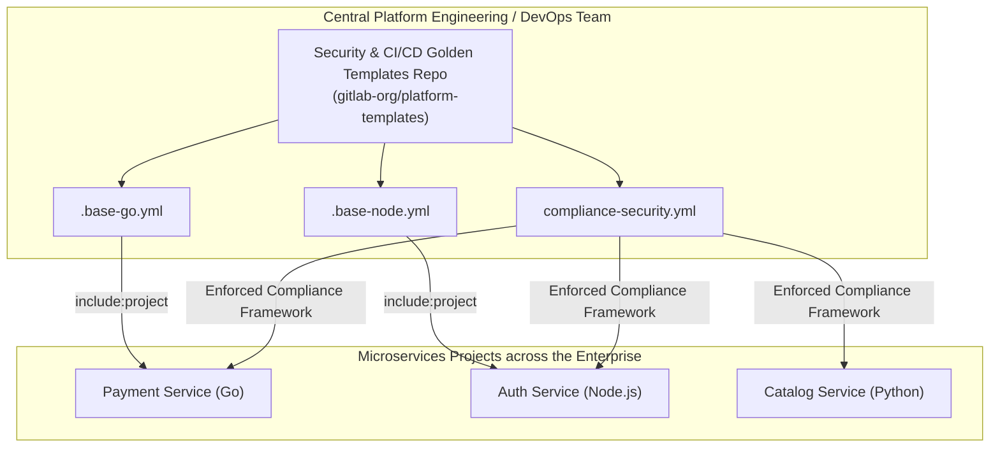
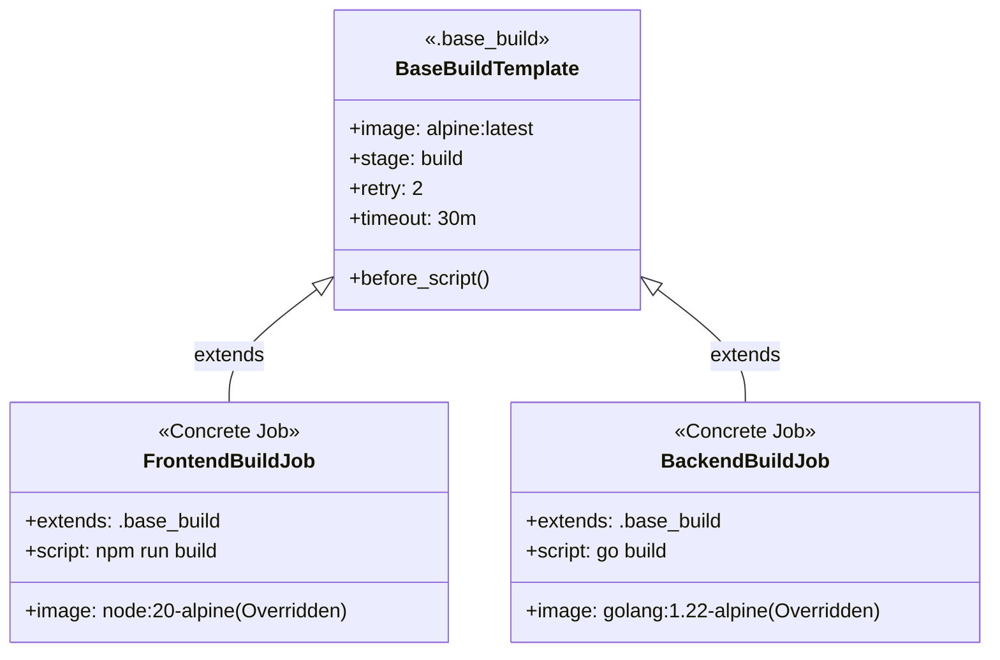
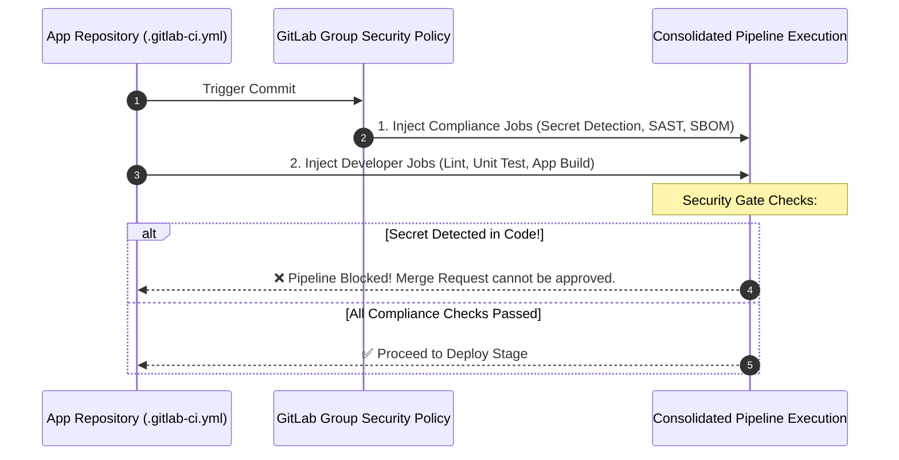

# Lesson 4: Reusable CI/CD Architecture & Corporate Governance

> **Objective:** Microservices ဒါဇင်ပေါင်းများစွာရှိသော Enterprise Environment တွင် CI/CD Pipeline များ ထပ်ခါတလဲလဲ ရေးသားရခြင်း (Code Duplication) ကို တားဆီးရန်၊ **Platform Engineering Principles** အရ Modularity (`include:`), Job Inheritance (`extends:`, `.hidden_job`), **GitLab CI/CD Components Catalog** နှင့် Organization-wide **Compliance Pipelines** ကို တည်ဆောက်နိုင်စေရန်။

---

## 1. Enterprise Problem: Pipeline Sprawl & Copy-Paste Anti-pattern

အဖွဲ့အစည်းတစ်ခုတွင် Microservices ၅၀ မှ ၁၀၀ ကျော် ရှိလာသောအခါ Repository တစ်ခုစီ၌ `.gitlab-ci.yml` ကို copy-paste လုပ်ထားပါက:
1. Docker image tag သို့မဟုတ် Security tool version အသစ်ပြောင်းတိုင်း Repositories အားလုံးတွင် လိုက်လံပြင်ဆင်ရခြင်း (Maintenance Nightmare)။
2. Developer များမှ Security Scanners (SAST, Secret scan) များကို ဖျက်ပစ်ခြင်း သို့မဟုတ် bypass လုပ်ခြင်း (Compliance Failure)။
3. Pipeline syntax စံချိန်စံညွှန်း မညီမျှခြင်း (Lack of Standardization) စသည့် ပြဿနာများ ဖြစ်ပေါ်လာပါသည်။



---

## 2. Modularity with `include:`

GitLab CI/CD သည် Configuration များကို ဖိုင်ခွဲထုတ်ပြီး ပြန်လည်ပေါင်းစပ်နိုင်ရန် `include` syntax ကို ထောက်ပံ့ပေးထားပါသည်။

| Include Type | Syntax ဥပမာ | အသုံးပြုရမည့် အခြေအနေ |
| :--- | :--- | :--- |
| `include:local` | `local: 'ci/test-stage.gitlab-ci.yml'` | လက်ရှိ Repository အတွင်း ဖိုင်ရှည်လျားလွန်းပါက sub-files များအဖြစ် ခွဲထုတ်ရန် |
| `include:project` | `project: 'my-group/ci-templates'`<br>`ref: 'v2.1.0'`<br>`file: '/templates/kaniko.yml'` | **(Enterprise Standard)** ဗဟို DevOps Repository ထံမှ Versioned Templates များကို microservices များတွင် ဆွဲသုံးရန် |
| `include:template` | `template: 'Security/SAST.gitlab-ci.yml'` | GitLab Built-in Security & AutoDevOps templates များကို သုံးရန် |
| `include:remote` | `remote: 'https://gitlab.com/.../raw/main.yml'` | External URL မှ templates ဆွဲသုံးရန် (Firewall သတိပြုရမည်) |

---

## 3. Job Inheritance: `extends:` vs Hidden Jobs (`.base_job:`)

YAML Syntax အရ အမည်ရှေ့တွင် Dot (`.`) ပါသော Job များကို GitLab Coordinator သည် Pipeline ပေါ်တွင် တိုက်ရိုက် run ပေးမည် မဟုတ်ပါ။ ၎င်းတို့ကို **Hidden Jobs (Reference Templates)** ဟု ခေါ်ဆိုပါသည်။



### `extends:` ၏ အားသာချက်:
- **Clean Architecture:** Default parameters (timeout, retries, tags, rules) များကို Base template တွင် တစ်နေရာတည်း သတ်မှတ်ထားနိုင်ပါသည်။
- **Deep Merging:** Base job ရှိ configuration များကို Child job မှ လိုအပ်သလို Override လုပ်နိုင်ပါသည်။

---

## 4. Modern Standard: GitLab CI/CD Component Catalog (GitLab 16+)

GitLab 16 မှစတင်၍ Legacy include templates များထက် ပိုမိုခေတ်မီသော **CI/CD Components** စနစ်ကို မိတ်ဆက်ခဲ့ပါသည်။ 
Component တစ်ခုစီတွင် Semantic Versioning (`1.0.0`), Input Parameters validation နှင့် Documentation များ ပါဝင်ပါသည်။

### 4.1 Component Definition File (`templates/kaniko-build.yml`):
```yaml
spec:
  inputs:
    stage:
      default: build
      description: "Pipeline stage for container build"
    image_tag:
      default: "$CI_COMMIT_SHORT_SHA"
      description: "Destination tag for container"
---
kaniko_build_component:
  stage: $[[ inputs.stage ]]
  image:
    name: gcr.io/kaniko-project/executor:debug
    entrypoint: [""]
  script:
    - /kaniko/executor --context "${CI_PROJECT_DIR}" --destination "${CI_REGISTRY_IMAGE}:$[[ inputs.image_tag ]]"
```

### 4.2 Application `.gitlab-ci.yml` မှ Component ကို ခေါ်ယူသုံးစွဲပုံ:
```yaml
include:
  - component: $CI_SERVER_FQDN/my-org/components/kaniko-build@1.2.0
    inputs:
      stage: package
      image_tag: "release-v1.0"
```

---

## 5. Enterprise Centralized Compliance Pipeline

Enterprise Organization များတွင် SOC2, PCI-DSS သို့မဟုတ် ISO 27001 Audits အောင်မြင်ရန်အတွက် Developer များ မည်သို့ပင် ရေးသားစေကာမူ အမြဲတမ်း ပူးတွဲ run ပေးရမည့် **Compliance Framework Pipelines** ကို GitLab Group Level တွင် သတ်မှတ်နိုင်ပါသည်။



---

## 6. Full Working Example: Central Reusable Architecture

### File 1: Central Templates Repo (`ci-templates/common.yml`)
```yaml
# ==============================================================================
# Central Template: Common Job Definitions
# ==============================================================================

# Reusable Hidden Job: Standard Deployment Notification
.base_notify:
  image: curlimages/curl:latest
  after_script:
    - >-
      curl -X POST -H 'Content-type: application/json'
      --data "{\"text\":\"Job $CI_JOB_NAME on branch $CI_COMMIT_BRANCH finished with status: $CI_JOB_STATUS\"}"
      $SLACK_WEBHOOK_URL

# Reusable Hidden Job: Enterprise Kubernetes Deployment
.base_k8s_deploy:
  image: bitnami/kubectl:1.29
  stage: deploy
  timeout: 15m
  retry:
    max: 2
    when:
      - runner_system_failure
      - stuck_or_timeout_failure
  before_script:
    - kubectl config set-cluster k8s --server="$KUBE_URL" --insecure-skip-tls-verify=true
    - kubectl config set-credentials admin --token="$KUBE_TOKEN"
    - kubectl config set-context default --cluster=k8s --user=admin
    - kubectl config use-context default
```

### File 2: Application Repository (`.gitlab-ci.yml`)
```yaml
# ==============================================================================
# Microservice Application .gitlab-ci.yml
# ==============================================================================

stages:
  - test
  - deploy

include:
  # 1. Centralized Security Scan from GitLab built-in
  - template: Jobs/Secret-Detection.gitlab-ci.yml
  - template: Jobs/SAST.gitlab-ci.yml
  # 2. Company DevOps Platform Templates
  - project: 'enterprise-core/ci-templates'
    ref: 'v1.4.0'
    file: '/templates/common.yml'

# Application Test
unit_test:
  stage: test
  image: node:20-alpine
  script:
    - npm ci
    - npm test

# Deploy to Staging using inherited template
deploy_staging:
  extends: 
    - .base_k8s_deploy
    - .base_notify # Multiple inheritance support
  variables:
    KUBE_URL: $STAGING_KUBE_URL
    KUBE_TOKEN: $STAGING_KUBE_TOKEN
  script:
    - kubectl set image deployment/auth-service auth-service=$CI_REGISTRY_IMAGE:$CI_COMMIT_SHORT_SHA -n staging
    - kubectl rollout status deployment/auth-service -n staging
  rules:
    - if: '$CI_COMMIT_BRANCH == "develop"'
```

---

## 7. Platform Engineering Checklist

> [!IMPORTANT]
> 1. **Pin Versions with Git Tags:** `include:project` ကို အသုံးပြုသည့်အခါ `ref: main` ဟု မသုံးပါနှင့်။ `ref: 'v1.2.0'` ကဲ့သို့ Semantic Version Tags ကိုသာ အမြဲသုံးပါ။ သို့မဟုတ်ပါက Central template ပြင်ဆင်လိုက်သည်နှင့် downstream microservices အားလုံး pipeline broken ဖြစ်သွားနိုင်ပါသည်။
> 2. **Limit Template Complexity:** Templates များထဲတွင် complex bash scripts များကို အလွန်အကျွံ မထည့်ပါနှင့်။ Bash logic များ ရှုပ်ထွေးလာပါက Custom CLI Tool (Go/Python) ရေးပြီး Container image တစ်ခုအဖြစ် သီးခြား maintain လုပ်ခြင်းက ပိုမို စိတ်ချရပါသည်။
