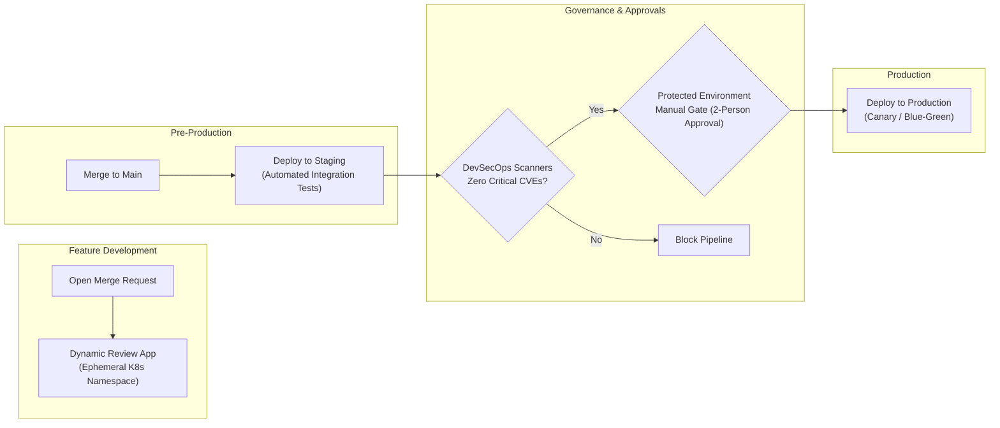
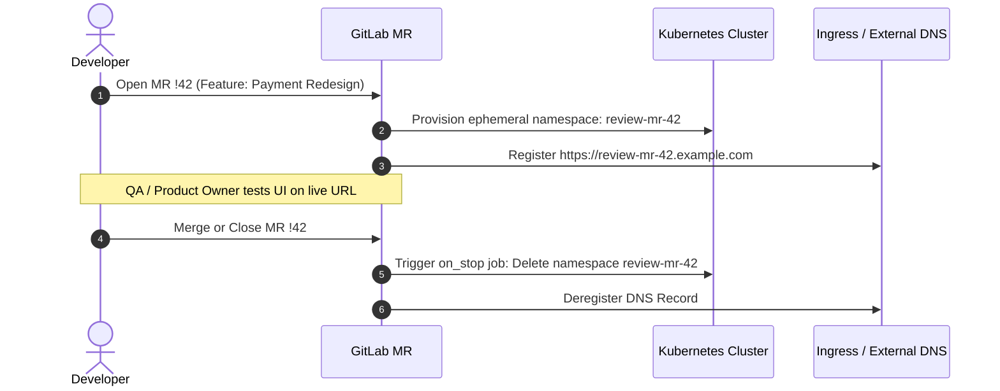

# Lesson 5: Multi-Environment Deployments, GitOps & Security Gates

> **Objective:** GitLab CI/CD ၏ အဆင့်မြင့် Environment Management စနစ်များဖြစ်သော **Dynamic Review Apps**, **Protected Environments & Manual Approval Gates**, လုံခြုံစိတ်ချရသော **Secrets Management (Masked, Protected, Vault OIDC)** နှင့် Built-in **DevSecOps Security Scanners** (SAST, Secret Detection, Container Scanning) များကို Enterprise Production စံချိန်စံညွှန်းအတိုင်း တည်ဆောက်နိုင်စေရန်။

---

## 1. Multi-Environment Promotion Lifecycle

Enterprise Software Delivery တွင် Code ပြောင်းလဲမှုများသည် တိုက်ရိုက် Production သို့ မရောက်ရှိမီ အဆင့်ဆင့်သော Quality & Security Gates များကို ဖြတ်သန်းရပါသည်။



---

## 2. Dynamic Ephemeral Review Apps

**Review App** ဆိုသည်မှာ Developer တစ်ဦး Merge Request (MR) အသစ်တစ်ခု ဖွင့်လိုက်တိုင်း သက်ဆိုင်ရာ Feature Branch အတွက် ယာယီ (ephemeral) Environment တစ်ခုကို Dynamic URL (ဥပမာ `https://mr-42.preview.company.com`) ဖြင့် K8s ပေါ်တွင် auto-deploy လုပ်ပေးသည့် စနစ်ဖြစ်ပါသည်။



### Review App ၏ အဓိက သတ်မှတ်ချက်များ:
- `environment:name`: Dynamic name ပေးရန် (ဥပမာ `review/$CI_COMMIT_REF_SLUG`)။
- `environment:url`: Web browser တွင် တိုက်ရိုက်ဖွင့်နိုင်သော URL။
- `environment:on_stop`: MR ပိတ်သိမ်းသွားပါက အရင်းအမြစ်များကို ပြန်လည်ဖျက်ဆီး (teardown) ပေးမည့် Cleanup job နာမည်။
- `environment:auto_stop_in`: Developer မှ MR မပိတ်ဘဲ မေ့ကျန်ခဲ့ပါက Cloud Cost မကုန်စေရန် သတ်မှတ်ထားသော အချိန် (ဥပမာ `1 week`, `2 days`) တွင် auto-delete ပြုလုပ်ပေးခြင်း။

---

## 3. Secrets Management: Protected, Masked & HashiCorp Vault OIDC

CI/CD Pipeline များတွင် Database Passwords, API Keys များကို လုံခြုံစွာ ကိုင်တွယ်ရန် GitLab တွင် အဆင့်သုံးဆင့် ရှိပါသည်။

```mermaid
flowchart TD
    subgraph Level1 [Level 1: Static Variables]
        V1["GitLab CI/CD Variables<br/>(Masked & Protected)"]
    end

    subgraph Level2 [Level 2: File-Type Variables]
        V2["Kubeconfig, Private Keys<br/>(Passed as temporary files)"]
    end

    subgraph Level3 [Level 3: Zero-Trust Vault OIDC (Recommended)]
        GL_JWT["GitLab CI Job Token (JWT)"] -->|OIDC Authentication| Vault["HashiCorp Vault"]
        Vault -->|Validates Audience & Claims| Vault
        Vault -->|Issues Ephemeral Dynamic Credentials| Runner["Runner Job (Valid for 15 mins)"]
    end
```

### 3.1 Masked & Protected Variables
- **Protected Variables:** `Protected` အဖြစ် သတ်မှတ်ထားသော Branches (main) သို့မဟုတ် Protected Tags များတွင်သာ အသုံးပြုနိုင်ပါသည်။ Feature branch များမှ လျှို့ဝှက်ချက်များကို ခိုးယူမရအောင် ကာကွယ်ပေးပါသည်။
- **Masked Variables:** Job Log ထဲတွင် တန်ဖိုးအစစ်အမှန် မပေါ်ဘဲ `[MASKED]` အဖြစ် ဖုံးကွယ်ပေးပါသည်။ (Base64 characters များ သို့မဟုတ် Regex ကန့်သတ်ချက်များ ရှိပါသည်)။

### 3.2 HashiCorp Vault JWT/OIDC Integration (No Static Credentials)
Long-lived Cloud API Keys (AWS IAM Secret Keys, Database passwords) များကို GitLab Variable ထဲတွင် hardcode သိမ်းမည့်အစား GitLab OpenID Connect (OIDC) JWT Token ကို အသုံးပြု၍ Vault ထံမှ Short-lived Temporary Token ကို dynamic တောင်းယူခြင်းက Enterprise Best Practice ဖြစ်ပါသည်။

---

## 4. Built-in DevSecOps Scanners (Shift-Left Security)

GitLab Ultimate တွင် အပိုဆောင်း software များ install လုပ်စရာမလိုဘဲ Standard Templates ဖြင့် အောက်ပါ Scanners များကို အလွယ်တကူ ထည့်သွင်းနိုင်ပါသည်:

1. **SAST (Static Application Security Testing):** Source code ထဲရှိ SQL Injection, XSS, Buffer Overflow စသည့် Code-level vulnerabilities များကို စစ်ဆေးပေးပါသည်။
2. **Secret Detection:** Code ထဲတွင် မတော်တဆ commit လုပ်မိသော AWS Keys, Private SSH Keys, Slack Webhooks များကို ရှာဖွေတားဆီးပေးပါသည်။
3. **Dependency Scanning:** `package.json`, `pom.xml`, `go.mod` စသည့် third-party open-source libraries များထဲရှိ CVE Vulnerabilities များကို စစ်ဆေးပေးပါသည်။
4. **Container Scanning (Trivy / Grype):** တည်ဆောက်ထားသော Docker Container OS packages များ (Debian, Alpine) ထဲရှိ vulnerabilities များကို စစ်ဆေးပေးပါသည်။

---

## 5. Production-Ready GitLab CI Configuration

အောက်ပါ `.gitlab-ci.yml` တွင် Review Apps, Staging, Protected Production Environment (Manual Gate) နှင့် DevSecOps Scanners များကို အပြည့်အစုံ ပေါင်းစပ်ရေးသားထားပါသည်။

```yaml
# ==============================================================================
# Enterprise Production Pipeline: Multi-Environment, Security & GitOps
# ==============================================================================

stages:
  - test
  - security
  - review
  - staging
  - production

# ------------------------------------------------------------------------------
# Include GitLab Security Scanners
# ------------------------------------------------------------------------------
include:
  - template: Jobs/Secret-Detection.gitlab-ci.yml
  - template: Jobs/SAST.gitlab-ci.yml
  - template: Jobs/Dependency-Scanning.gitlab-ci.yml

# Global Variables
variables:
  SECURE_LOG_LEVEL: "info"
  REVIEW_DOMAIN: "preview.devops-lab.com"

# ------------------------------------------------------------------------------
# 1. Automated Unit & Integration Tests
# ------------------------------------------------------------------------------
test:unit:
  stage: test
  image: node:20-alpine
  script:
    - npm ci
    - npm test

# ------------------------------------------------------------------------------
# 2. Dynamic Review App (Ephemeral MR Environments)
# ------------------------------------------------------------------------------
deploy:review:
  stage: review
  image: alpine/k8s:1.29.2
  environment:
    name: review/$CI_COMMIT_REF_SLUG
    url: https://$CI_COMMIT_REF_SLUG.$REVIEW_DOMAIN
    on_stop: stop:review
    auto_stop_in: 3 days
  rules:
    - if: '$CI_PIPELINE_SOURCE == "merge_request_event"'
  script:
    - echo "Deploying ephemeral environment for MR !$CI_MERGE_REQUEST_IID"
    - kubectl create namespace review-$CI_COMMIT_REF_SLUG --dry-run=client -o yaml | kubectl apply -f -
    - kubectl apply -f k8s/review-deployment.yaml -n review-$CI_COMMIT_REF_SLUG

stop:review:
  stage: review
  image: alpine/k8s:1.29.2
  environment:
    name: review/$CI_COMMIT_REF_SLUG
    action: stop
  rules:
    - if: '$CI_PIPELINE_SOURCE == "merge_request_event"'
      when: manual
  script:
    - echo "Teardown review app namespace: review-$CI_COMMIT_REF_SLUG"
    - kubectl delete namespace review-$CI_COMMIT_REF_SLUG --ignore-not-found=true

# ------------------------------------------------------------------------------
# 3. Continuous Delivery to Staging
# ------------------------------------------------------------------------------
deploy:staging:
  stage: staging
  image: alpine/k8s:1.29.2
  environment:
    name: staging
    url: https://staging.devops-lab.com
  rules:
    - if: '$CI_COMMIT_BRANCH == $CI_DEFAULT_BRANCH'
  script:
    - echo "Deploying to Staging Environment..."
    - kubectl set image deployment/web-app web-app=$CI_REGISTRY_IMAGE:$CI_COMMIT_SHORT_SHA -n staging
    - kubectl rollout status deployment/web-app -n staging

# ------------------------------------------------------------------------------
# 4. Protected Production Environment with Manual Approval Gate
# ------------------------------------------------------------------------------
deploy:production:
  stage: production
  image: alpine/k8s:1.29.2
  environment:
    name: production
    url: https://app.devops-lab.com
  rules:
    - if: '$CI_COMMIT_BRANCH == $CI_DEFAULT_BRANCH'
      when: manual # Operator မှ GitLab UI ပေါ်တွင် Confirm ခလုတ်နှိပ်မှသာ run မည်
  script:
    - echo "Executing Zero-Downtime Rolling Update on Production Cluster..."
    - kubectl set image deployment/web-app web-app=$CI_REGISTRY_IMAGE:$CI_COMMIT_SHORT_SHA -n production
    - kubectl rollout status deployment/web-app -n production --timeout=300s
```

---

## 6. Enterprise Security Governance Checklist

> [!CAUTION]
> 1. **Protected Environments Setup:** `Settings > CI/CD > Protected Environments` တွင် Production environment ကို configure လုပ်ပါ။ Production သို့ deploy လုပ်ခွင့်ကို သတ်မှတ်ထားသော Lead Engineers သို့မဟုတ် Release Managers များထံသာ ကန့်သတ်ထားရှိပါ။
> 2. **Never Print Secrets in Scripts:** CI Script ထဲတွင် `set -x` (Bash debug mode) သုံးပါက Secret variables များသည် plaintext အနေဖြင့် Terminal log ထဲသို့ ရောက်ရှိသွားနိုင်ပါသည်။ စစ်ဆေးရန်လိုအပ်ပါက Masked output စနစ်ကို အမြဲတမ်း စစ်ဆေးပါ။
