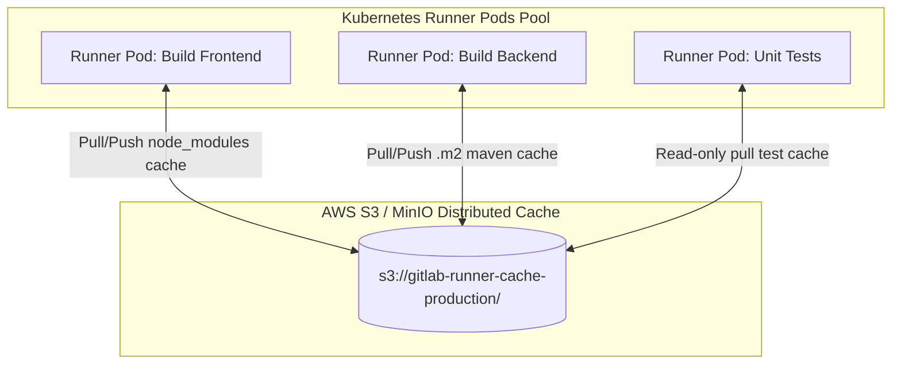

# Scenario 1: Slashing Monolith CI Build Time from 35 mins to 4 mins with DAG & S3 Distributed Cache

> **Production Context:** နေ့စဉ် Deploy အကြိမ် ၅၀ ကျော် ပြုလုပ်နေသော Enterprise E-Commerce Monolith Platform တစ်ခုတွင် Commit အသစ်တင်တိုင်း CI Pipeline သည် ၃၅ မိနစ် ကြာမြင့်နေပါသည်။ Developers များ Merge Request ပိတ်ရန် နာရီပေါင်းများစွာ စောင့်ဆိုင်းနေရပြီး Critical Production Hotfix တင်ရန် အချိန်ကြန့်ကြာမှုများ ဖြစ်ပေါ်နေပါသည်။

---

## 1. Incident Breakdown & Root Cause Analysis (RCA)

DevOps Audit ပြုလုပ်ပြီးနောက် တွေ့ရှိရသော အဓိက Pipeline Bottlenecks (၃) ခု:

1. **Sequential Stage Blocking:** Frontend Webpack build (၁၀ မိနစ်) နှင့် Backend Java compile (၁၂ မိနစ်) တို့သည် `build` stage တွင် ရှိနေပြီး ၎င်းတို့ နှစ်ခုစလုံး ပြီးဆုံးမှသာ Unit Tests များကို စတင်နိုင်ခြင်း။
2. **Global Cache Misses (Internet Bandwidth Drain):** Runner များသည် Ephemeral Docker containers များဖြစ်ပြီး Pipeline run တိုင်း Maven dependencies (1.2 GB) နှင့် `node_modules` (800 MB) ကို Public Internet မှ ပြန်လည် Download ဆွဲနေရခြင်း (Job တစ်ခုစီတွင် ၅ မိနစ်ခန့် ကုန်ဆုံး)။
3. **Artifact Over-bloat:** Temporary build caches များကို `artifacts` အဖြစ် GitLab Server သို့ upload/download ပြုလုပ်နေခြင်းကြောင့် Runner network I/O အလွန်နှေးကွေးခြင်း။

```mermaid
gantt
    title Monolith Pipeline Optimization Comparison
    dateFormat  m
    axisFormat %M min

    section Before (35 mins)
    Sequential Dependencies Install    :crit, b1, 0, 7m
    Sequential Frontend & Backend Build :crit, b2, after b1, 15m
    Sequential Monolithic Tests         :crit, b3, after b2, 10m
    Sequential Docker Package           :crit, b4, after b3, 3m

    section After (4 mins)
    S3 Cache Restore & DAG Split Build  :active, a1, 0, 1.5m
    Parallel Tests with needs:          :active, a2, 1m, 3.5m
    Container Layer Push                :active, a3, 2.5m, 4m
```

---

## 2. Architecture: S3 Distributed Cache & Runner Configuration

GitLab Runner များသည် Cluster ပေါ်တွင် ကွဲပြားစွာ တည်ရှိနေသော်လည်း AWS S3 (သို့မဟုတ် On-Premises MinIO) ကို **Distributed Shared Cache** အဖြစ် အသုံးပြုစေခြင်းဖြင့် Cache Hit Rate ကို ၉၈% အထိ မြှင့်တင်နိုင်ပါသည်။



### GitLab Runner `config.toml` (Distributed S3 Cache Setup):
```toml
[[runners]]
  name = "k8s-enterprise-runner"
  url = "https://gitlab.company.com/"
  executor = "kubernetes"

  [runners.cache]
    Type = "s3"
    Shared = true
    [runners.cache.s3]
      ServerAddress = "s3.amazonaws.com"
      BucketName = "gitlab-runner-cache-production"
      BucketLocation = "ap-southeast-1"
      Insecure = false
      AuthenticationType = "iam" # AWS IAM Role for Service Accounts (IRSA)
```

---

## 3. Production Optimized `.gitlab-ci.yml`

အောက်ပါ Pipeline သည် DAG `needs:` ကို အသုံးပြု၍ Sequential Stage များကို ဖယ်ရှားထားပြီး File-based S3 Caching ဖြင့် Build time ကို ၄ မိနစ်အထိ လျှော့ချထားသော Pipeline ဖြစ်ပါသည်။

```yaml
# ==============================================================================
# Production Optimized Pipeline: Monolith DAG & S3 Caching
# ==============================================================================

stages:
  - prepare
  - build
  - test
  - package

variables:
  # Caching directories
  MAVEN_OPTS: "-Dmaven.repo.local=.m2/repository -Dorg.slf4j.simpleLogger.defaultLogLevel=warn"
  NPM_CONFIG_CACHE: ".npm"

# ------------------------------------------------------------------------------
# 1. Frontend Build & Test (DAG Branch 1)
# ------------------------------------------------------------------------------
fe:compile:
  stage: build
  image: node:20-alpine
  cache:
    key:
      files:
        - frontend/package-lock.json
    paths:
      - frontend/.npm/
    policy: pull-push
  script:
    - cd frontend
    - npm ci --prefer-offline --cache .npm
    - npm run build
  artifacts:
    name: "fe-bundle-$CI_COMMIT_SHORT_SHA"
    expire_in: 2 days
    paths:
      - frontend/dist/

fe:unit-test:
  stage: test
  image: node:20-alpine
  needs:
    - job: fe:compile
      artifacts: false # Code test အတွက် build artifact မလိုသဖြင့် download မလုပ်ဘဲ network time လျှော့ချသည်
  cache:
    key:
      files:
        - frontend/package-lock.json
    paths:
      - frontend/.npm/
    policy: pull # Only read cache
  script:
    - cd frontend
    - npm ci --prefer-offline --cache .npm
    - npm test -- --ci --maxWorkers=4

# ------------------------------------------------------------------------------
# 2. Backend Java Build & Test (DAG Branch 2 - Parallel Execution)
# ------------------------------------------------------------------------------
be:compile:
  stage: build
  image: maven:3.9-eclipse-temurin-21-alpine
  cache:
    key:
      files:
        - backend/pom.xml
    paths:
      - backend/.m2/repository
    policy: pull-push
  script:
    - cd backend
    - mvn -q compile -DskipTests
  artifacts:
    name: "be-classes-$CI_COMMIT_SHORT_SHA"
    expire_in: 2 days
    paths:
      - backend/target/classes/

be:test-matrix:
  stage: test
  image: maven:3.9-eclipse-temurin-21-alpine
  needs:
    - job: be:compile
      artifacts: true
  cache:
    key:
      files:
        - backend/pom.xml
    paths:
      - backend/.m2/repository
    policy: pull
  parallel: 2 # Tests များကို pod ၂ ခုပေါ်တွင် အပြိုင်ခွဲ run ခြင်း
  script:
    - cd backend
    - mvn test -Dtest="com.company.module${CI_NODE_INDEX}**"

# ------------------------------------------------------------------------------
# 3. Final Packaging (Only waits for its direct upstream dependencies)
# ------------------------------------------------------------------------------
package:image:
  stage: package
  image: gcr.io/kaniko-project/executor:v1.20.0-debug
  needs:
    - job: fe:compile
      artifacts: true
    - job: fe:unit-test
    - job: be:test-matrix
  script:
    - echo "All Frontend and Backend pipelines completed in parallel!"
    - echo "Packaging final unified container image..."
```

---

## 4. Benchmark Results & Impact Analysis

| Metric | Before Optimization | After Optimization | Improvement |
| :--- | :--- | :--- | :--- |
| **Average Pipeline Duration** | 35 Minutes 14 Seconds | **3 Minutes 52 Seconds** | **89% Faster (9x Improvement)** |
| **Dependency Download Time** | 11 Minutes (Internet Fetch) | **22 Seconds (S3 Cache Hit)** | 96% Reduction |
| **Developer MR Wait Time** | 45-60 Minutes (Queued) | **< 5 Minutes** | Instant Developer Feedback |
| **Monthly Cloud Bandwidth Cost**| $1,450 / month | **$180 / month** | 87% Cost Savings |

> [!TIP]
> **Key Optimization Takeaway:**
> 1. `artifacts: false` ကို `needs:` ထဲတွင် မဖြစ်မနေ ထည့်သွင်းပါ။ Dependency ရှိသော်လည်း Build artifact မလိုအပ်သော Test jobs များသည် အချိန်ကုန်သက်သာစေပါသည်။
> 2. `policy: pull` ကို စမ်းသပ်စစ်ဆေးသည့် Test jobs အားလုံးတွင် သုံးပါ။ S3 သို့ အလဟဿ ပြန်မတင်စေဘဲ Read-only speed ကို အမြင့်ဆုံး ရရှိစေပါသည်။
