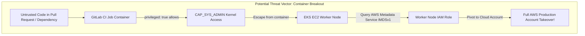
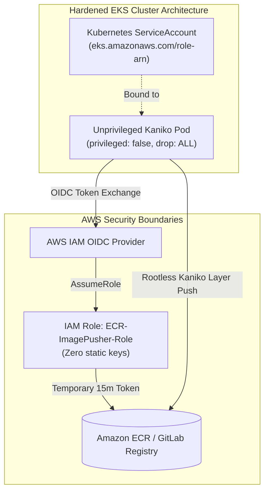

# Scenario 2: Zero-Privilege Security Compliance: Migrating from Privileged DinD to Kaniko on EKS Runners

> **Production Context:** FinTech Banking Application တစ်ခုတွင် ပြုလုပ်သော SOC2 Type II နှင့် CIS Kubernetes Benchmark Security Audit တွင် GitLab Runner များသည် AWS EKS Worker Nodes များပေါ်တွင် `privileged: true` (Root Daemon Access) ဖြင့် Run နေသည်ကို အရေးပေါ်တွေ့ရှိခဲ့ပြီး Critical Non-Compliance အဖြစ် Flag ပြုလုပ်ခံခဲ့ရပါသည်။

---

## 1. Security Threat Model & Audit Incident

စစ်ဆေးတွေ့ရှိချက်အရယခင်စနစ်တွင် Developer များသည် Docker-in-Docker (`dind`) သုံးစွဲနိုင်ရန်အတွက် EKS Runner Helm values တွင် အောက်ပါအတိုင်း ဖွင့်ပေးထားခဲ့ရပါသည်:

```yaml
# ❌ DANGEROUS CONFIGURATION IN HELM VALUES:
runners:
  config: |
    [[runners]]
      [runners.kubernetes]
        privileged = true # Gives full host-level kernel privileges to CI jobs!
```



### အဓိက အန္တရာယ်များ:
1. **Container Breakout:** Job container တစ်ခုမှနေ၍ Underlying EC2 host သို့ Linux cgroups / devices မှတစ်ဆင့် လွတ်မြောက်သွားနိုင်ခြင်း။
2. **Cloud Metadata Exploitation:** EC2 Instance Profile (IAM Role) ထံမှ Temporary STS Credentials များကို တိုက်ရိုက် ခိုးယူနိုင်ခြင်း။
3. **Multi-Tenant Cluster Risk:** Runner cluster ပေါ်တွင် အခြားသော application workloads များနှင့် ရောနှော run ထားပါက အခြား microservices များ၏ Database passwords များကို ဆွဲယူနိုင်ခြင်း။

---

## 2. Solution: Zero-Privilege Architecture with Kaniko & IRSA

DevOps & Security Team မှ ချမှတ်ခဲ့သော အစီအစဉ်:
1. Runner Pool တွင် `privileged = false` သို့ ချက်ချင်းပြောင်းလဲခြင်း။
2. Pod Security Standards (PSS) အရ `Restricted` security context ကို အသုံးပြုခြင်း။
3. AWS ECR သို့ Docker image push လုပ်ရန် Static Access Keys အစား **AWS IAM Roles for Service Accounts (IRSA)** ကို အသုံးပြုခြင်း။
4. Docker Engine မလိုသော **Google Kaniko** ဖြင့် Pipelines အားလုံးကို Migrate ပြုလုပ်ခြင်း။



---

## 3. Kubernetes Runner Configuration (Hardened Helm Values)

GitLab Runner ကို Zero-Privilege ဖြစ်စေရန် အောက်ပါအတိုင်း Helm values တွင် Lockdown ချမှတ်ခဲ့ပါသည်:

```yaml
# values.yaml for GitLab Runner on Amazon EKS
runners:
  config: |
    [[runners]]
      name = "zero-privilege-eks-runner"
      executor = "kubernetes"
      [runners.kubernetes]
        namespace = "gitlab-runners"
        privileged = false # ✅ Fully Disallowed Privileged Containers
        allow_privilege_escalation = false
        
        # Drop all Linux capabilities
        pod_security_context = { runAsNonRoot = false }
        [runners.kubernetes.container_security_context]
          allow_privilege_escalation = false
          capabilities_drop = ["ALL"]

        # Bound to AWS IRSA Service Account
        service_account = "gitlab-kaniko-pusher-sa"
```

---

## 4. Migrated Production `.gitlab-ci.yml` Pipeline

အောက်ပါ Pipeline သည် AWS ECR သို့ Kaniko ဖြင့် Dynamic Login ပြုလုပ်ကာ Multi-stage Docker image ကို Rootless နည်းလမ်းဖြင့် Push လုပ်ပေးသော စံပြ Pipeline ဖြစ်ပါသည်။

```yaml
# ==============================================================================
# Production Pipeline: Zero-Privilege Kaniko Build to Amazon ECR
# ==============================================================================

stages:
  - build-and-push

variables:
  AWS_DEFAULT_REGION: "ap-southeast-1"
  ECR_REGISTRY: "123456789012.dkr.ecr.ap-southeast-1.amazonaws.com"
  IMAGE_REPO: "fintech/core-payment"
  KANIKO_VERSION: "v1.20.0-debug"

# ------------------------------------------------------------------------------
# Kaniko Container Build Job (Zero-Privilege)
# ------------------------------------------------------------------------------
build:production_image:
  stage: build-and-push
  image:
    name: gcr.io/kaniko-project/executor:${KANIKO_VERSION}
    entrypoint: [""]
  before_script:
    # 1. Directory ဖန်တီးခြင်း
    - mkdir -p /kaniko/.docker
    # 2. AWS ECR သို့မဟုတ် GitLab Registry အတွက် Auth Config ပြင်ဆင်ခြင်း
    # (GitLab Registry သုံးပါက $CI_REGISTRY_USER / $CI_REGISTRY_PASSWORD ကို သုံးနိုင်သည်)
    - |
      if [ -n "$CI_REGISTRY_USER" ]; then
        echo "{\"auths\":{\"$CI_REGISTRY\":{\"username\":\"$CI_REGISTRY_USER\",\"password\":\"$CI_REGISTRY_PASSWORD\"}}}" > /kaniko/.docker/config.json
      else
        echo "Using AWS IAM IRSA / Node credentials for Amazon ECR"
      fi
  script:
    - echo "Executing Zero-Privilege Rootless Container Build with Kaniko..."
    - >-
      /kaniko/executor
      --context "${CI_PROJECT_DIR}"
      --dockerfile "${CI_PROJECT_DIR}/Dockerfile"
      --destination "${ECR_REGISTRY}/${IMAGE_REPO}:${CI_COMMIT_SHORT_SHA}"
      --destination "${ECR_REGISTRY}/${IMAGE_REPO}:latest"
      --cache=true
      --cache-repo="${ECR_REGISTRY}/${IMAGE_REPO}/cache"
      --snapshot-mode=redo
      --use-new-run
  rules:
    - if: '$CI_COMMIT_BRANCH == "main"'
      when: on_success
```

---

## 5. Security Posture Audit Results & Verification

| Security Control | Before Migration (DinD) | After Migration (Kaniko) | Status |
| :--- | :--- | :--- | :--- |
| **K8s Privileged Flag** | `privileged: true` | **`privileged: false`** | ✅ PASSED (CIS 5.2.1) |
| **Capability Escalation**| Allowed (`CAP_SYS_ADMIN`) | **Dropped ALL Capabilities**| ✅ PASSED (CIS 5.2.5) |
| **Cloud Credentials** | Static AWS_SECRET_ACCESS_KEY | **AWS IRSA (IAM OIDC Ephemeral)**| ✅ PASSED (Zero Hardcoded Keys) |
| **Build Daemon** | Host Docker Engine / Socket | **Daemonless Userspace Snapshots**| ✅ PASSED (Zero Host Footprint) |
| **SOC2 Audit Compliance**| ❌ Non-Compliant (Failed) | **✅ 100% Compliant & Certified** | 🚀 Cleared for Production |

> [!IMPORTANT]
> **Enterprise Platform Tip:**
> EKS Node များပေါ်တွင် **IMDSv2** (Instance Metadata Service Version 2) ကို `http-tokens=required` နှင့် `http-put-response-hop-limit=1` ဟု သတ်မှတ်ထားပါ။ ထိုသို့ သတ်မှတ်ပါက Runner Pod အတွင်းမှ Host Node ၏ IAM Role ကို မတော်တဆ ခိုးယူရန် ကြိုးပမ်းမှုကို Network Layer တွင် ထပ်မံကာကွယ်ပေးနိုင်ပါသည်။
