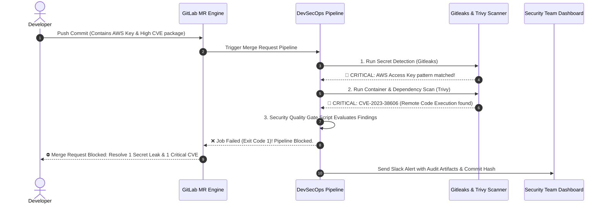
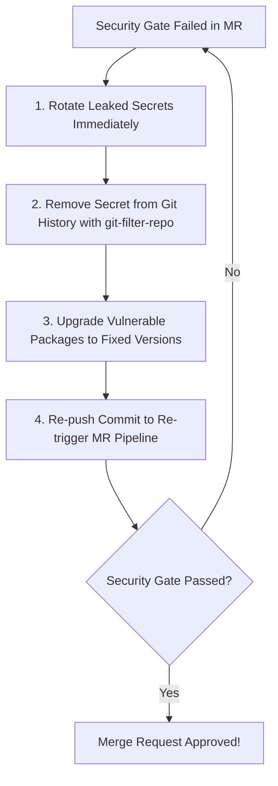

# Scenario 3: Enterprise DevSecOps Gate: Blocking Leaked Secrets and Critical CVEs before Staging Merge

> **Production Context:** Developer တစ်ဦးမှ Testing ပြုလုပ်ရန်အတွက် Production AWS Access Key နှင့် Remote Code Execution (RCE) Vulnerability (Critical CVE) ပါဝင်သော Third-Party Dependency အဟောင်းတစ်ခုကို Feature Branch ထဲသို့ မတော်တဆ Commit တင်ခဲ့ပါသည်။ အကယ်၍ ယခင်စနစ်အတိုင်း Merge ခွင့်ပြုလိုက်ပါက Cloud Account Compromise ဖြစ်ပြီး Staging Database အားလုံး ပျက်စီးနိုင်သည့် အရေးပေါ်အခြေအနေ ဖြစ်ခဲ့ပါသည်။

---

## 1. Incident Timeline & Attack Prevention Workflow

DevSecOps Pipeline Gate သည် Developer မှ Merge Request (MR) တင်လိုက်သည့်အခိုက်တွင် အောက်ပါအတိုင်း အလိုအလျောက် စစ်ဆေးပြီး MR ကို ပိတ်ပင် (block) တားဆီးခဲ့ပါသည်:



---

## 2. DevSecOps Architecture: Quality Gate Criteria

Enterprise Policy အရ Production/Staging Branch သို့ Merge ပြုလုပ်ရန် အောက်ပါ **Pass/Fail Criteria** ကို တိကျစွာ ချမှတ်ထားပါသည်:

| Security Domain | Scanner Tool | Blocking Threshold (Fail Pipeline) | Exception Policy |
| :--- | :--- | :--- | :--- |
| **Secret Detection** | Gitleaks / GitLab Secret Detection | **>= 1 Leaked Secret** (Zero Tolerance) | No exception allowed. Secret must be revoked immediately! |
| **Dependencies (SCA)** | Trivy / GitLab Dependency Scanning | **>= 1 CRITICAL or HIGH CVE** | Security Lead မှ Risk Waiver Form တင်မှသာ ခြွင်းချက်ခွင့်ပြုမည် |
| **Static Code (SAST)** | Semgrep / GitLab SAST | **>= 1 CRITICAL Vulnerability** | Fix code or apply sanitization filter |
| **Container Image** | Trivy Container Scanner | **>= 1 CRITICAL OS CVE** | Base image ကို Distroless သို့မဟုတ် Latest Patch သို့ ပြောင်းရမည် |

---

## 3. Production DevSecOps Pipeline Configuration

အောက်ပါ `.gitlab-ci.yml` တွင် Security Scanners များကို အပြိုင် run ပြီး ရလဒ် JSON reports များကို Python/Shell Security Gate Script ဖြင့် parse လုပ်ကာ Threshold ကျော်လွန်ပါက Merge ကို အလိုအလျောက် တားဆီးပေးသော ကုဒ်ဖြစ်ပါသည်။

```yaml
# ==============================================================================
# Production DevSecOps Quality Gate Pipeline
# ==============================================================================

stages:
  - test
  - security-scan
  - security-gate
  - build

# ------------------------------------------------------------------------------
# 1. Secret Detection Job (Gitleaks)
# ------------------------------------------------------------------------------
scan:secrets:
  stage: security-scan
  image: 
    name: zricethezav/gitleaks:v8.18.2
    entrypoint: [""]
  script:
    - echo "Scanning commit history for exposed credentials, tokens, and keys..."
    - gitleaks detect --source="${CI_PROJECT_DIR}" --verbose --report-path=gitleaks-report.json --report-format=json --exit-code=0
  artifacts:
    name: "secrets-report-$CI_COMMIT_SHORT_SHA"
    when: always
    paths:
      - gitleaks-report.json
    expire_in: 7 days

# ------------------------------------------------------------------------------
# 2. Dependency & Vulnerability Scan (Trivy)
# ------------------------------------------------------------------------------
scan:dependencies:
  stage: security-scan
  image:
    name: aquasec/trivy:0.49.1
    entrypoint: [""]
  script:
    - echo "Scanning application dependencies and filesystem for CVEs..."
    - >-
      trivy fs
      --format json
      --output trivy-report.json
      --severity CRITICAL,HIGH
      --exit-code 0
      "${CI_PROJECT_DIR}"
  artifacts:
    name: "trivy-report-$CI_COMMIT_SHORT_SHA"
    when: always
    paths:
      - trivy-report.json
    expire_in: 7 days

# ------------------------------------------------------------------------------
# 3. Security Quality Gate (The Blocking Engine)
# ------------------------------------------------------------------------------
security:quality_gate:
  stage: security-gate
  image: python:3.11-alpine
  needs:
    - job: scan:secrets
      artifacts: true
    - job: scan:dependencies
      artifacts: true
  before_script:
    - apk add --no-cache jq
  script:
    - echo "=========================================================="
    - echo "🛡️ EVALUATING ENTERPRISE SECURITY QUALITY GATE POLICIES"
    - echo "=========================================================="
    - |
      python3 - << 'EOF'
      import json, sys

      has_violations = False

      # 1. Evaluate Gitleaks Secret Report
      try:
          with open('gitleaks-report.json', 'r') as f:
              secrets = json.load(f)
              if secrets and len(secrets) > 0:
                  print(f"❌ [SECURITY VIOLATION]: Found {len(secrets)} exposed secret(s) in code!")
                  for s in secrets:
                      print(f"   - Rule: {s.get('Description')} in File: {s.get('File')}:L{s.get('StartLine')}")
                  has_violations = True
              else:
                  print("✅ [PASSED]: Zero hardcoded secrets detected.")
      except FileNotFoundError:
          print("⚠️ Warning: gitleaks-report.json not found.")

      # 2. Evaluate Trivy Vulnerability Report
      try:
          with open('trivy-report.json', 'r') as f:
              trivy_data = json.load(f)
              critical_count = 0
              results = trivy_data.get('Results', [])
              for res in results:
                  vulns = res.get('Vulnerabilities', [])
                  for v in vulns:
                      if v.get('Severity') == 'CRITICAL':
                          critical_count += 1
                          print(f"❌ [CRITICAL CVE]: {v.get('VulnerabilityID')} in {v.get('PkgName')} ({v.get('InstalledVersion')})")
              
              if critical_count > 0:
                  print(f"❌ [SECURITY VIOLATION]: Found {critical_count} CRITICAL CVE vulnerabilities!")
                  has_violations = True
              else:
                  print("✅ [PASSED]: Zero CRITICAL vulnerabilities found.")
      except FileNotFoundError:
          print("⚠️ Warning: trivy-report.json not found.")

      if has_violations:
          print("\n⛔ SECURITY QUALITY GATE FAILED! Merge Request blocked.")
          sys.exit(1)
      else:
          print("\n🎉 SECURITY QUALITY GATE PASSED! Ready for deployment.")
          sys.exit(0)
      EOF
  rules:
    - if: '$CI_PIPELINE_SOURCE == "merge_request_event"'
    - if: '$CI_COMMIT_BRANCH == $CI_DEFAULT_BRANCH'
```

---

## 4. Remediation Standard Operating Procedure (SOP)

အကယ်၍ Developer တစ်ဦး၏ Pipeline သည် Security Gate တွင် ကျရှုံးခဲ့ပါက အောက်ပါ SOP အတိုင်း ဖြေရှင်းရပါမည်:



> [!WARNING]
> **Git Secret Revocation Rule:**
> Code ထဲတွင် Secret တစ်ခု leak ဖြစ်သွားပါက ၎င်း commit ကို ပြန်ဖျက်ရုံ (revert) ဖြင့် လုံးဝမလုံလောက်ပါ။ Git commit history သို့မဟုတ် Public mirror များတွင် ကျန်ရှိနေနိုင်သောကြောင့် **သက်ဆိုင်ရာ Cloud Console သို့ သွားရောက်၍ Exposed Access Key ကို ချက်ချင်း Revoke (Deactivate) ပြုလုပ်ပြီး Key အသစ် ပြန်လည်ထုတ်ယူရပါမည်**။
