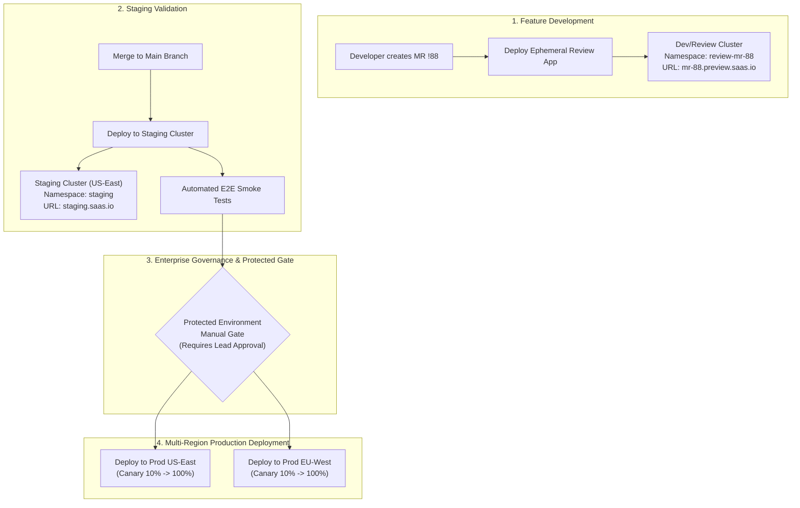
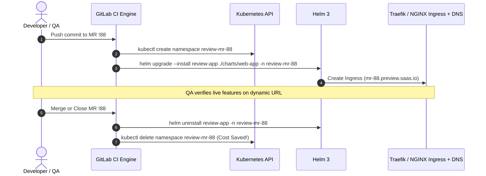

# Scenario 4: Automated Kubernetes Multi-Cluster CD with Ephemeral Review Apps & Protected Production Manual Gates

> **Production Context:** Global SaaS platform တစ်ခုတွင် Developers ၃၀ ကျော်သည် Feature အသစ်များကို တပြိုင်နက်တည်း develop လုပ်နေကြပါသည်။ အဖွဲ့ဝင်များ အချင်းချင်း Staging server တစ်ခုတည်းပေါ်တွင် overwrite မဖြစ်စေရန်အတွက် Dynamic Ephemeral Review Apps စနစ်နှင့် Multi-Cluster Production Deployment (US-East & EU-West) အတွက် လုံခြုံစိတ်ချရသော Protected Manual Gate စနစ်ကို တည်ဆောက်ခြင်း။

---

## 1. Multi-Cluster Architecture & Delivery Flow

ဤစနစ်တွင် Kubernetes Cluster သုံးခု (Review/Dev, Staging, Multi-Region Production) ကို GitLab CI/CD ဖြင့် ချိတ်ဆက် စီမံခန့်ခွဲထားပါသည်။



---

## 2. Dynamic Ephemeral Review Apps Architecture

MR တစ်ခုစီအတွက် သီးခြား Namespace နှင့် Dynamic Ingress Hostname ဖန်တီးပေးပြီး cert-manager မှ Let's Encrypt SSL Certificate ကို အလိုအလျောက် ထုတ်ပေးပါသည်။



---

## 3. Production Multi-Cluster Deployment Pipeline (`.gitlab-ci.yml`)

အောက်ပါ Pipeline သည် Ephemeral Review App များအတွက် dynamic deployment/teardown ပါဝင်ပြီး Multi-Cluster Production Rollout ကို Manual Gate ဖြင့် ထိန်းချုပ်ထားသော Production Configuration ဖြစ်ပါသည်။

```yaml
# ==============================================================================
# Production Pipeline: Kubernetes Multi-Cluster CD with Ephemeral Review Apps
# ==============================================================================

stages:
  - test
  - review
  - staging
  - production-gate
  - production-deploy

variables:
  APP_NAME: "saas-portal"
  REVIEW_DOMAIN: "preview.saas.io"

# ------------------------------------------------------------------------------
# 1. Ephemeral Review App Deploy
# ------------------------------------------------------------------------------
review:deploy:
  stage: review
  image: alpine/helm:3.14.2
  environment:
    name: review/$CI_COMMIT_REF_SLUG
    url: https://$CI_COMMIT_REF_SLUG.$REVIEW_DOMAIN
    on_stop: review:teardown
    auto_stop_in: 2 days
  rules:
    - if: '$CI_PIPELINE_SOURCE == "merge_request_event"'
  script:
    - echo "Deploying Helm Release for Review App: $CI_COMMIT_REF_SLUG"
    - kubectl config use-context platform/k8s-agents:dev-cluster
    - >-
      helm upgrade --install ${APP_NAME}-${CI_COMMIT_REF_SLUG} ./chart
      --namespace review-${CI_COMMIT_REF_SLUG}
      --create-namespace
      --set image.tag=${CI_COMMIT_SHORT_SHA}
      --set ingress.host=${CI_COMMIT_REF_SLUG}.${REVIEW_DOMAIN}

review:teardown:
  stage: review
  image: alpine/helm:3.14.2
  environment:
    name: review/$CI_COMMIT_REF_SLUG
    action: stop
  rules:
    - if: '$CI_PIPELINE_SOURCE == "merge_request_event"'
      when: manual
  script:
    - echo "Cleaning up resources for MR !$CI_MERGE_REQUEST_IID"
    - kubectl config use-context platform/k8s-agents:dev-cluster
    - helm uninstall ${APP_NAME}-${CI_COMMIT_REF_SLUG} -n review-${CI_COMMIT_REF_SLUG} || true
    - kubectl delete namespace review-${CI_COMMIT_REF_SLUG} --ignore-not-found=true

# ------------------------------------------------------------------------------
# 2. Automated Staging Deployment
# ------------------------------------------------------------------------------
deploy:staging:
  stage: staging
  image: alpine/helm:3.14.2
  environment:
    name: staging
    url: https://staging.saas.io
  rules:
    - if: '$CI_COMMIT_BRANCH == $CI_DEFAULT_BRANCH'
  script:
    - echo "Deploying to Staging Kubernetes Cluster..."
    - kubectl config use-context platform/k8s-agents:staging-cluster
    - >-
      helm upgrade --install ${APP_NAME} ./chart
      --namespace staging
      --set image.tag=${CI_COMMIT_SHORT_SHA}
      --wait --timeout 5m

# ------------------------------------------------------------------------------
# 3. Multi-Cluster Production Deployment (Manual Approval Gates)
# ------------------------------------------------------------------------------
deploy:prod-us-east:
  stage: production-deploy
  image: alpine/helm:3.14.2
  environment:
    name: production/us-east
    url: https://us.saas.io
  rules:
    - if: '$CI_COMMIT_BRANCH == $CI_DEFAULT_BRANCH'
      when: manual # Operator Approval Gate
  script:
    - echo "Deploying to US-East Production Cluster..."
    - kubectl config use-context platform/k8s-agents:prod-us-east
    - >-
      helm upgrade --install ${APP_NAME} ./chart
      --namespace production
      --set image.tag=${CI_COMMIT_SHORT_SHA}
      --wait --timeout 7m

deploy:prod-eu-west:
  stage: production-deploy
  image: alpine/helm:3.14.2
  environment:
    name: production/eu-west
    url: https://eu.saas.io
  rules:
    - if: '$CI_COMMIT_BRANCH == $CI_DEFAULT_BRANCH'
      when: manual # Operator Approval Gate
  script:
    - echo "Deploying to EU-West Production Cluster..."
    - kubectl config use-context platform/k8s-agents:prod-eu-west
    - >-
      helm upgrade --install ${APP_NAME} ./chart
      --namespace production
      --set image.tag=${CI_COMMIT_SHORT_SHA}
      --wait --timeout 7m
```

---

## 4. Protected Environments & Governance Setup in GitLab UI

1. **Navigate to:** `Settings > CI/CD > Protected Environments`.
2. **Select Environment:** `production/us-east` နှင့် `production/eu-west`.
3. **Approval Rules:**
   - **Allowed to Deploy:** Release Managers Group (Developers cannot trigger this job).
   - **Required Approvals:** `2` (Four-eyes principle: Lead DevOps + QA Lead must approve before execution).
4. **Unified Deployment Audit Trail:** GitLab Dashboard တွင် မည်သူက မည်သည့် Commit SHA ကို မည်သည့်အချိန်တွင် Production သို့ Approve လုပ်ခဲ့သည်ကို အပြည့်အစုံ Audit Log သိမ်းဆည်းပေးပါသည်။
